
# 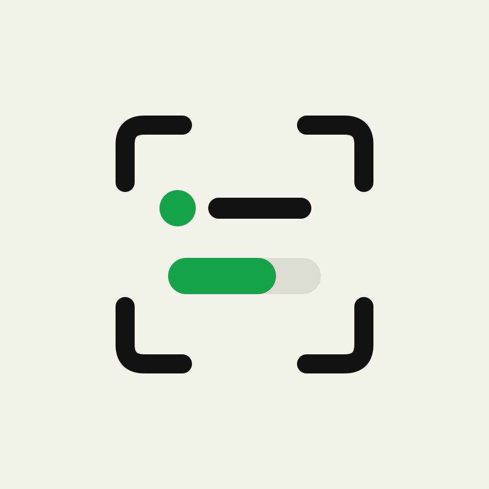 Kick Streamer Overlay Pack

Free OBS overlays for [Kick](https://kick.com): goal bars, a viewer and uptime panel, a chat overlay, follow, subscription, gift and Kicks alerts, a "starting soon" countdown, a rotating announcement bar, and a studio that gives you a ready link for each overlay. The basic setup needs no server and no account.

    

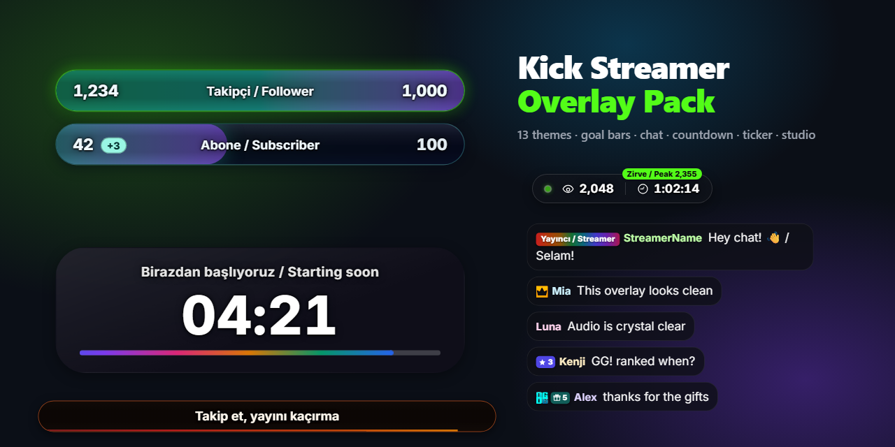

**Read this in:** [English](#english) · [Türkçe](#turkce)

---

## English

### Overview

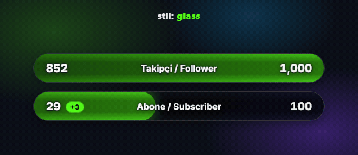

Each of the 13 themes in turn, with sample numbers. The bars fill and a light sweep crosses the fill.

Open `studio.html`, enter your channel name, pick a look, and copy the link of each overlay into an OBS Browser source. The overlays read Kick's public channel data directly. If the optional relay is running, they ask it first instead. The relay keeps the answers for a few seconds, so several overlays share one request to Kick.

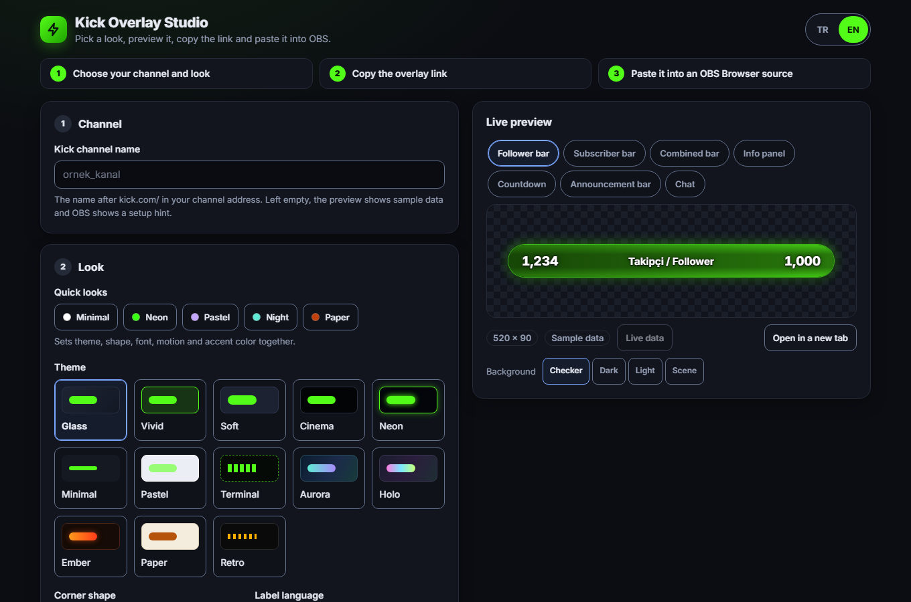

| Feature | Status (checked 2026-11-03) |
|---|---|
| Follower goal | Works. The number on screen matches Kick's public count for kick.com/iacbi. |
| Viewers and uptime | Works from Kick's public data. Not yet checked on a live broadcast. |
| Subscriber total | Needs a free Kick developer app (see [Configuration](docs/setup.md#subscriber-total-kick-app)). Checked with a real app on 2026-11-03: the token and channel lookup work, and the count (0) matches the channel. Not yet checked with a channel that has subscribers. Without an app, enter the count by hand. |
| Live chat | Works through the optional relay (see [Live chat](docs/relay.md#live-chat-and-alerts)). Needs a Kick app and a public tunnel. Checked with a real message sent in kick.com/iacbi's chat on 2026-11-03: it went from Kick through a Cloudflare tunnel and the relay's signature check onto the overlay. Without the relay, `chat.html` stays empty instead of showing fake messages. |
| Alerts | Same relay and setup as live chat. Tested with signed test events built from the payloads in Kick's documentation, in a real browser; not yet with live Kick delivery. |

### Features

- 13 themes: `glass`, `vivid`, `soft`, `cinema`, `neon`, `minimal`, `pastel`, `terminal`, `aurora`, `holo`, `ember`, `paper`, `retro` ([gallery and look links](docs/themes.md))
- Corner shapes (`pill`, `rounded`, `square`), four fonts (only the one you pick is loaded), labels in Turkish, English, Spanish, Brazilian Portuguese, German or Arabic (right to left), or Turkish and English together, three motion levels, and an optional percentage. Reduced-motion settings are respected everywhere
- A session gain next to the subscriber count, such as "+3 this stream". It survives an OBS refresh for 12 hours
- Goal bars pulse at 25, 50 and 75 %, and show a goal-reached state at 100 % (`hedefKutlama`). With `hedefArtis` a reached goal moves up by a set step instead
- A countdown to a length in minutes or to a clock time (`geriSayimSaat`), and an announcement bar that rotates your lines. Both work without any Kick data
- Chat filters: hide `!` commands and named users such as bots, and fade messages out after a set time. A message of emotes alone shows them larger, and `sohbetYatay` puts the chat in one row for a strip along the screen edge
- Custom CSS for every overlay (`ozelCss`), checked so it can only restyle the page and never load anything from elsewhere
- An info panel with viewers, uptime, peak viewers and, optionally, the stream title (`bilgiBaslik`). With the relay it switches the moment the stream starts or ends
- An alerts overlay for new followers, new and renewed subscriptions, gifted subscriptions, Kicks and channel point rewards. One card at a time; during a raid the queue keeps at most 25 and drops the oldest follows first. Each alert type can be turned off. Each type plays its own short sound, and your own sound and image or video can replace it
- A Kicks goal bar and a sub train (subscriptions in a row, with the time left to keep it going) for the current stream
- A recent events list and a leaderboard (top gifters or top Kicks senders) for the current stream. The numbers start over when the stream goes live, survive a relay restart, and can be cleared from the dock. The relay also writes them as plain text files for OBS Text sources
- Preview mode (`?onizleme=1`) with sample numbers and no network calls, and a status box with `?debug=1`
- Studio in Turkish, English, Spanish, Brazilian Portuguese, German and Arabic: live preview with a tab per overlay, quick looks, a copy-link button for each overlay or all of them, JSON export and import of the look (credentials are never included), the `AYARLAR.js` file as an alternative, a step-by-step relay check, and a connection test for your Kick app
- Every setting also has an English name (`channel`, `theme`, `followerGoal` …), in `AYARLAR.js` and in links
- The studio tells you when a newer release is out (one request to GitHub a day at most)
- Built for OBS: animations use `transform` and `opacity`. Polls back off when Kick is slow or limits requests, pause while the page is hidden, and never overlap. Chat reconnects by itself, and no Kick data is ever inserted as HTML

### Requirements

- OBS Studio with Browser sources
- A Kick channel name
- Optional: a Kick developer app (client ID and secret) for the subscriber total
- For the relay: Node.js 20 or newer, or the relay executable from the [releases page](https://github.com/IACBI/kick-streamer-overlays/releases), which needs no Node.js
- Node.js 20 or newer, for the tests
- Optional, for live chat: a tunnel tool such as `cloudflared` or `ngrok`

### Installation

**Try it online first:** [iacbi.github.io/kick-streamer-overlays](https://iacbi.github.io/kick-streamer-overlays/) has the studio and every overlay. Links copied there work in OBS as they are, for everything that needs no relay ([details](docs/setup.md#try-it-online)).

**Recommended: with the relay app.** Links never change, and every edit reaches OBS with one click.

1. From the [releases page](https://github.com/IACBI/kick-streamer-overlays/releases), download `kick-streamer-overlays-vX.Y.Z.zip` and the relay for your system (`kick-relay-win-x64.exe`, `kick-relay-macos-arm64`, …). Unpack the zip somewhere permanent and put the relay in that folder.
2. Start the relay (double-click it, or run `node relay/server.js`). It opens the studio at `http://127.0.0.1:8790/`.
3. Enter your channel name, pick a look, and press **Save and apply to OBS**.
4. Press **Copy link** on an overlay. In OBS add **Sources → + → Browser**, turn **Local file** off, paste the link (`http://127.0.0.1:8790/follower-bar.html`) into **URL**, and set the size shown on the card.

From then on, change anything in the studio and press **Save**: every overlay in OBS updates within a few seconds. Live chat, alerts and the subscriber total need a free Kick app and a tunnel on top. The studio's **Live features** checklist walks you through it, and the relay app starts the tunnel by itself once [cloudflared](https://developers.cloudflare.com/cloudflare-one/connections/connect-networks/downloads/) is installed. Details: [docs/relay.md](docs/relay.md).

**On your own server:** run the relay in Docker behind your HTTPS address, so chat and alerts keep working without a tunnel or the streaming PC: [docs/cloud.md](docs/cloud.md).

**Without the relay:** open `studio.html` from the unpacked folder, pick a look, and copy the links. A link then carries your settings, so after a change copy it again.

**All overlays at once, the control dock, and the Local file method:** see [docs/setup.md](docs/setup.md).

A link holds only your public settings, never your Kick app credentials.

### Usage

| File | Shows | OBS size (W × H) |
|---|---|---|
| `follower-bar.html` | Follower goal | 520 × 90 |
| `subscriber-bar.html` | Subscriber goal | 520 × 90 |
| `combined-bar.html` | Followers and subscribers in one panel | 520 × 180 |
| `info-panel.html` | Viewers and uptime, shown only while live | 300 × 80 |
| `chat.html` | Live chat (needs the relay) | 460 × 760 |
| `alerts.html` | Follow, subscription, gift and Kicks alerts (needs the relay) | 640 × 200 |
| `countdown.html` | "Starting soon" countdown that starts when the source loads | 520 × 190 |
| `ticker.html` | Announcement bar that rotates your lines | 760 × 80 |
| `events.html` | Recent follows, subscriptions, gifts and Kicks of this stream (needs the relay) | 420 × 400 |
| `leaderboard.html` | Top gifters or top Kicks senders of this stream (needs the relay) | 380 × 400 |
| `kicks-bar.html` | Kicks goal for this stream (needs the relay) | 520 × 90 |
| `sub-train.html` | Sub train: subscriptions in a row and the time left; hidden while no train runs (needs the relay) | 520 × 90 |
| `studio.html` | Studio: previews, settings and links. Open it in a browser, not in OBS | — |

These previews use sample data (`?onizleme=1`), so they show the design and make no request to Kick.

  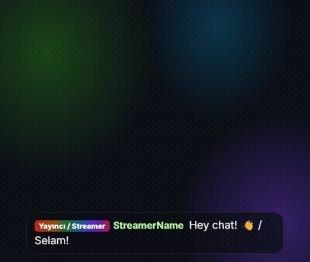 
  <b>Chat preview.</b> Messages arrive one by one and the feed keeps a fixed number. The crown is badge art from <code>badges/</code>.

  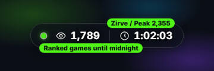 
  <b>Info panel.</b> The viewer count eases up and the uptime counts every second while the channel is live. The title tag at the bottom is optional (<code>bilgiBaslik</code>).

  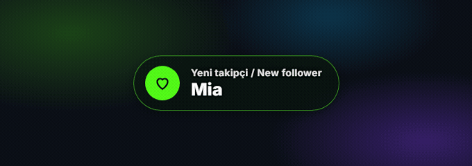 
  <b>Alerts.</b> One card at a time: follows, new and renewed subscriptions, gifted subscriptions and Kicks. Each type can be turned off.

  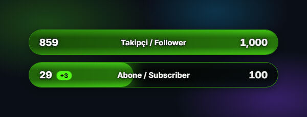 
  <b>Combined panel.</b> Both goal bars fill smoothly. The chip shows how many subscribers were gained during this stream.

  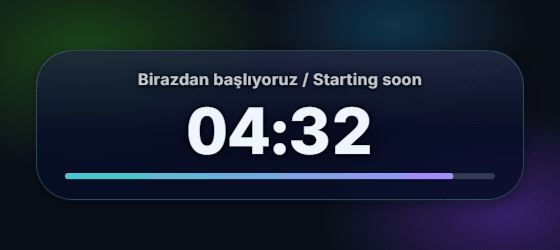 
  <b>Countdown.</b> Put it on your "starting soon" scene. The clock starts when the source loads, so refreshing the source restarts it. At zero it shows "Going live!".

  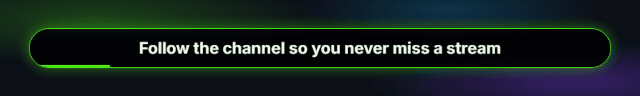 
  <b>Announcement bar.</b> Your lines rotate with a soft transition. A thin line shows when the next one arrives.

Something not showing? See [docs/troubleshooting.md](docs/troubleshooting.md). Live chat, alerts, stream stats and the dock need the relay: [docs/relay.md](docs/relay.md).

### Configuration

Every setting lives in `AYARLAR.js`, and the studio writes the same settings into the links it gives you. A link overrides `AYARLAR.js`. An invalid value falls back to its default, and numbers are limited to their range. Yes/no settings accept `true`/`false`, `yes`/`no`, `on`/`off` or `1`/`0`. The studio writes the English names; the original Turkish names work too, and win if a file or link gives both.

The most used ones: `channel`, `theme`, `language` (label language: `tr`, `en`, `both`, `es`, `pt`, `de`, `ar`), `accent`, and the goals `followerGoal`, `subscriberGoal` and `kicksGoal`. Every setting, with its values and default, is in [docs/settings.md](docs/settings.md).

Your own alert sounds and art, badge art, and the Kick app for the subscriber total: [docs/setup.md](docs/setup.md).

**Secrets and privacy.** Your client secret is read only from `AYARLAR.local.js`, from the `KICK_CLIENT_SECRET` environment variable, or from the studio's memory. It is never placed in a link, a saved draft, the JSON export or the generated settings file. In the browser, only `subscriber-bar.html` and `combined-bar.html` read it. The overlays contact `kick.com` (channel data), `api.kick.com` and `id.kick.com` (subscriber total, only with your app), `files.kick.com` (chat emotes), and Google Fonts (`fonts.googleapis.com`, `fonts.gstatic.com`) for the one typeface you pick. Live chat and relay answers come from `127.0.0.1`. The relay talks only to Kick, and checks every webhook signature before it accepts an event. [SECURITY.md](SECURITY.md) describes the full model.

### Contributing

- Unit tests: `node tests/run.js`. Relay tests: `node tests/relay-test.js`. Both need Node.js 20 or newer and no packages, and `npm test` runs them together.
- `npm ci` installs the development tools only: ESLint, TypeScript (type-checks the JavaScript through JSDoc), esbuild and postject (relay executable). The overlays and the relay still need no packages. `npm run check` runs lint, the type check, the core build and version checks and both test suites. The browser core is written in small parts under `src/core/`; `npm run build:core` joins them into `shared/kick-core.js`.
- `npm run build:relay` builds the relay executable for your platform into `dist/`, and `npm run test:relay-binary` starts it from an empty folder and checks it.
- GitHub Actions runs both suites on Node.js 20, 22 and 24 on Ubuntu and Windows, plus lint, the type check, the Chrome tests with the relay, the visual contrast gate, the relay executable on both systems and CodeQL, for every push to `main` and every pull request. Pushing a `vX.Y.Z` tag publishes the release with the zip, the executables and their checksums.
- Browser tests: `node tests/e2e-chrome.js`. They need Chrome or Edge. Add `--live --channel <name>` for real Kick data, `--token` for the local mock, `--preview` for sample mode, `--perf` for a 30-second heap and DOM check, and `--relay` for live chat through the relay with signed test events.
- Translations are JSON files in `i18n/overlay/` (overlays and dock) and `i18n/studio/` (studio), one per language with the keys of `en.json`. `npm run build:lang` turns them into the scripts in `shared/lang/`, and `npm run i18n:status` shows what each language is missing. To add or fix a language, see [docs/translating.md](docs/translating.md).
- Pages must stay classic scripts so they work from `file://`. Use the shared `.ko-*` components and tokens in `shared/themes.css`, and prefer `transform` and `opacity` for new animations.
- `node tools/record-previews.js` re-creates the images in `screenshots/` (needs Node.js 22 or newer, Chrome or Edge, and `ffmpeg`).
- `node tools/visual-qa.js --out <dir>` and `node tools/motion-qa.js --out <dir>` check every theme for readability and every animation for smoothness before a change ships (Node.js 22 or newer, Chrome). Add `--only main,lang --gate` to fail on any text below its contrast target or any layout issue, in every label language, as CI does.
- Guides: [setup](docs/setup.md), [relay](docs/relay.md), [server mode](docs/cloud.md), [settings](docs/settings.md), [theme gallery](docs/themes.md), [translating](docs/translating.md), [troubleshooting](docs/troubleshooting.md), [FAQ](docs/faq.md), [roadmap](docs/ROADMAP.md).
- More in [CONTRIBUTING.md](CONTRIBUTING.md), [SECURITY.md](SECURITY.md) and the [changelog](CHANGELOG.md).

### License

[MIT](LICENSE). Free for everyone, including commercial streaming; keep the copyright notice when you share the code. "Kick" and the role icons in `badges/` belong to their owners and are not covered by the license. This project is not affiliated with Kick.

© 2026 𝓐.𝓒.𝓑 · [kick.com/iacbi](https://kick.com/iacbi)

[⬆ Back to top](#top)

---

## Türkçe

### Genel Bakış

13 temanın her biri sırayla, örnek sayılarla. Çubuklar dolar ve dolgunun üzerinden bir ışık geçer.

`studio.html` dosyasını aç, kanal adını yaz, bir görünüm seç ve her overlay'in bağlantısını OBS'te bir Tarayıcı kaynağına yapıştır. Overlay'ler Kick'in herkese açık kanal verisini doğrudan okur. İsteğe bağlı relay çalışıyorsa önce ondan ister. Relay yanıtları birkaç saniye saklar; böylece birden çok overlay Kick'e tek bir istek paylaşır.

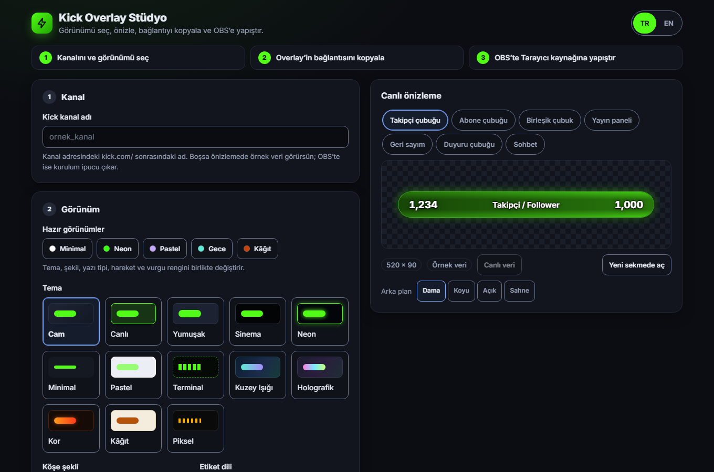

| Özellik | Durum (2026-11-03 kontrolü) |
|---|---|
| Takipçi hedefi | Çalışıyor. Ekrandaki sayı kick.com/iacbi için Kick'in herkese açık sayısıyla eşleşiyor. |
| İzleyici ve yayın süresi | Kick'in herkese açık verisinden çalışıyor. Canlı yayında henüz kontrol edilmedi. |
| Abone toplamı | Ücretsiz bir Kick geliştirici uygulaması gerektirir (bkz. [Yapılandırma](docs/setup.md#subscriber-total-kick-app)). 2026-11-03'te gerçek bir uygulamayla kontrol edildi: token alma ve kanal sorgusu çalışıyor, sayı (0) kanalla uyuşuyor. Abonesi olan bir kanalda henüz kontrol edilmedi. Uygulaman yoksa sayıyı elle gir. |
| Canlı sohbet | Opsiyonel relay ile çalışıyor (bkz. [Canlı sohbet](docs/relay.md#live-chat-and-alerts)). Bir Kick uygulaması ve herkese açık bir tünel gerektirir. 2026-11-03'te kick.com/iacbi chat'ine yazılan gerçek bir mesajla kontrol edildi: mesaj Kick'ten Cloudflare tüneli ve relay'in imza kontrolü üzerinden overlay'e ulaştı. Relay yoksa `chat.html` sahte mesaj yerine boş kalır. |
| Bildirimler | Canlı sohbetle aynı relay ve kurulum. Kick'in dokümantasyonundaki örnek verilerden üretilen imzalı test olaylarıyla gerçek bir tarayıcıda test edildi; gerçek Kick teslimatıyla henüz değil. |

### Özellikler

- 13 tema: `glass`, `vivid`, `soft`, `cinema`, `neon`, `minimal`, `pastel`, `terminal`, `aurora`, `holo`, `ember`, `paper`, `retro` ([galeri ve görünüm linkleri](docs/themes.md))
- Köşe şekilleri (`pill`, `rounded`, `square`), dört yazı tipi (yalnızca seçtiğin yüklenir), Türkçe, İngilizce, İspanyolca, Brezilya Portekizcesi, Almanca ya da Arapça (sağdan sola) veya Türkçe ve İngilizce birlikte etiketler, üç hareket seviyesi ve isteğe bağlı yüzde gösterimi. Hareket azaltma ayarları her yerde geçerlidir
- Abone sayısının yanında "bu yayında +3" gibi yayın içi artış. OBS'te kaynağı yenilesen de 12 saat boyunca korunur
- Hedef çubukları yüzde 25, 50 ve 75'te nabız atar, yüzde 100'de "hedefe ulaşıldı" durumuna geçer (`hedefKutlama`). `hedefArtis` ile ulaşılan hedef belirlenen adım kadar yükselir
- Dakika cinsinden ya da saat olarak (`geriSayimSaat`) geri sayım ve satırlarını döndüren duyuru çubuğu. İkisi de Kick verisi olmadan çalışır
- Sohbet filtreleri: `!` ile başlayan komutları ve bot gibi adı verilen kullanıcıları gizle, mesajları belli bir süre sonra soluklaştır. Yalnızca emote'tan oluşan mesajda emote'lar büyük görünür; `sohbetYatay` sohbeti ekran kenarındaki bir şerit için tek satıra dizer
- Tüm overlay'ler için özel CSS (`ozelCss`): yalnızca görünümü değiştirebilir, dışarıdan hiçbir şey yükleyemez
- İzleyici, yayın süresi, en yüksek izleyici sayısı ve istersen yayın başlığını (`bilgiBaslik`) gösteren bir yayın paneli. Relay açıksa yayın başlar başlamaz ya da biter bitmez değişir
- Yeni takipçi, yeni ve yenilenen abonelik, hediye abonelik, Kicks ve kanal puanı ödülleri için bildirim overlay'i. Kartlar tek tek gelir; raid sırasında sırada en çok 25 bildirim tutulur ve önce en eski takip bildirimleri atılır. Her bildirim türü ayrı ayrı kapatılabilir. Her tür kendi kısa sesini çalar; yerine kendi sesini ve görselini ya da videonu koyabilirsin
- O yayın için Kicks hedef çubuğu ve abone treni (art arda gelen abonelikler ve treni sürdürmek için kalan süre)
- O yayının son olayları ve liderlik tablosu (en çok hediye eden ya da Kicks gönderenler). Sayılar yayın başlayınca sıfırlanır, relay yeniden başlasa da korunur ve panelden elle sıfırlanabilir. Relay bunları OBS Metin kaynakları için düz metin dosyalarına da yazar
- Önizleme modu (`?onizleme=1`): ağ çağrısı yapmadan örnek sayılar gösterir. `?debug=1` ile küçük bir durum kutusu açılır
- Türkçe, İngilizce, İspanyolca, Brezilya Portekizcesi, Almanca ve Arapça stüdyo: her overlay için sekmeli canlı önizleme, hazır görünümler, her overlay için ya da hepsi için bağlantı kopyalama, görünümü JSON olarak dışa ve içe aktarma (kimlik bilgileri hiçbir zaman dahil edilmez), alternatif olarak `AYARLAR.js` dosyası, adım adım relay denetimi ve Kick uygulaman için bağlantı testi
- Her ayarın İngilizce bir adı da var (`channel`, `theme`, `followerGoal` …); `AYARLAR.js` dosyasında da bağlantılarda da çalışır
- Stüdyo yeni bir sürüm çıktığında haber verir (GitHub'a günde en fazla bir istek)
- OBS için tasarlandı: animasyonlar `transform` ve `opacity` kullanır. Kick yavaşladığında ya da istek sınırı koyduğunda sorgular geri çekilir, sayfa gizliyken durur ve hiçbir zaman üst üste binmez. Sohbet kendiliğinden yeniden bağlanır; Kick verisi hiçbir zaman HTML olarak eklenmez

### Gereksinimler

- Tarayıcı kaynağı destekleyen OBS Studio
- Bir Kick kanal adı
- İsteğe bağlı: abone toplamı için bir Kick geliştirici uygulaması (client ID ve client secret)
- Relay için Node.js 20 veya üstü ya da [sürümler sayfasındaki](https://github.com/IACBI/kick-streamer-overlays/releases) Node.js gerektirmeyen relay programı
- Testler için Node.js 20 veya üstü
- Opsiyonel, canlı sohbet için: `cloudflared` veya `ngrok` gibi bir tünel aracı

### Kurulum

**Önce çevrimiçi dene:** [iacbi.github.io/kick-streamer-overlays](https://iacbi.github.io/kick-streamer-overlays/) adresinde stüdyo ve tüm overlay'ler var. Oradan kopyalanan bağlantılar, relay gerektirmeyen her şey için OBS'te olduğu gibi çalışır ([ayrıntılar](docs/setup.md#try-it-online)).

**Önerilen yol: relay uygulamasıyla.** Bağlantılar hiç değişmez, her düzenleme tek tıkla OBS'e ulaşır.

1. [Sürümler sayfasından](https://github.com/IACBI/kick-streamer-overlays/releases) `kick-streamer-overlays-vX.Y.Z.zip` dosyasını ve sistemine uygun relay'i (`kick-relay-win-x64.exe`, `kick-relay-macos-arm64`, …) indir. Zip'i kalıcı bir yere aç ve relay'i o klasöre koy.
2. Relay'i başlat (çift tıkla ya da `node relay/server.js` çalıştır). Stüdyoyu `http://127.0.0.1:8790/` adresinde açar.
3. Kanal adını yaz, bir görünüm seç ve **Kaydet ve OBS'e uygula** düğmesine bas.
4. Bir overlay'in **Bağlantıyı kopyala** düğmesine bas. OBS'te **Kaynaklar → + → Tarayıcı** ekle, **Yerel dosya** kutusunu kapat, bağlantıyı (`http://127.0.0.1:8790/follower-bar.html`) **URL** kutusuna yapıştır ve boyutu kartta yazan değere ayarla.

Bundan sonra stüdyoda neyi değiştirirsen değiştir, **Kaydet**'e basman yeter: OBS'teki tüm overlay'ler birkaç saniye içinde güncellenir. Canlı sohbet, bildirimler ve abone sayısı için ayrıca ücretsiz bir Kick uygulaması ve tünel gerekir. Stüdyodaki **Canlı özellikler** kontrol listesi seni adım adım götürür; [cloudflared](https://developers.cloudflare.com/cloudflare-one/connections/connect-networks/downloads/) kuruluysa relay uygulaması tüneli kendisi açar. Ayrıntılar: [docs/relay.md](docs/relay.md) (İngilizce).

**Kendi sunucunda:** relay'i Docker ile kendi HTTPS adresinin arkasında çalıştır; sohbet ve bildirimler tünel ya da yayın bilgisayarı olmadan da çalışır: [docs/cloud.md](docs/cloud.md) (İngilizce).

**Relay olmadan:** açtığın klasördeki `studio.html` dosyasını aç, bir görünüm seç ve bağlantıları kopyala. Bu durumda bağlantı ayarlarını taşır; bir değişiklikten sonra yeniden kopyala.

**Tüm overlay'ler tek seferde, kontrol paneli ve Yerel dosya yöntemi:** [docs/setup.md](docs/setup.md) (İngilizce).

Bağlantı yalnızca herkese açık ayarlarını taşır, Kick uygulama bilgilerini asla.

### Kullanım

| Dosya | Gösterdiği | OBS boyutu (G × Y) |
|---|---|---|
| `follower-bar.html` | Takipçi hedefi | 520 × 90 |
| `subscriber-bar.html` | Abone hedefi | 520 × 90 |
| `combined-bar.html` | Takipçi ve aboneler tek panelde | 520 × 180 |
| `info-panel.html` | İzleyici ve yayın süresi, yalnızca yayındayken | 300 × 80 |
| `chat.html` | Canlı sohbet (relay gerektirir) | 460 × 760 |
| `alerts.html` | Takip, abonelik, hediye ve Kicks bildirimleri (relay gerektirir) | 640 × 200 |
| `countdown.html` | Kaynak yüklenince başlayan "birazdan başlıyoruz" geri sayımı | 520 × 190 |
| `ticker.html` | Satırlarını sırayla gösteren duyuru çubuğu | 760 × 80 |
| `events.html` | Bu yayının son takip, abonelik, hediye ve Kicks olayları (relay gerektirir) | 420 × 400 |
| `leaderboard.html` | Bu yayında en çok hediye eden ya da Kicks gönderenler (relay gerektirir) | 380 × 400 |
| `kicks-bar.html` | Bu yayının Kicks hedefi (relay gerektirir) | 520 × 90 |
| `sub-train.html` | Abone treni: art arda gelen abonelikler ve kalan süre; tren yokken gizlenir (relay gerektirir) | 520 × 90 |
| `studio.html` | Stüdyo: önizleme, ayarlar ve bağlantılar. OBS'de değil, tarayıcıda aç | — |

Buradaki tüm animasyonlar örnek veri kullanır (`?onizleme=1`); yani tasarımı gösterir ve Kick'e istek yapmaz.

   
  <b>Sohbet önizlemesi.</b> Mesajlar teker teker gelir ve akış sabit sayıda mesaj tutar. Taç, <code>badges/</code> klasöründeki rozet görselidir.

   
  <b>Yayın paneli.</b> İzleyici sayısı yumuşakça artar, kanal yayındayken süre her saniye ilerler. Alttaki başlık etiketi isteğe bağlıdır (<code>bilgiBaslik</code>).

   
  <b>Bildirimler.</b> Ekranda tek seferde bir kart: takip, yeni ve yenilenen abonelik, hediye abonelik ve Kicks. Her türü ayrı ayrı kapatabilirsin.

   
  <b>Birleşik panel.</b> İki hedef çubuğu yumuşakça dolar. Rozet, bu yayında kazanılan abone sayısını gösterir.

   
  <b>Geri sayım.</b> "Birazdan başlıyoruz" sahnene koy. Saat kaynak yüklenince başlar; kaynağı yenilersen yeniden başlar. Sıfırda "Başlıyoruz!" yazar.

   
  <b>Duyuru çubuğu.</b> Satırların yumuşak bir geçişle döner. İnce bir çizgi bir sonrakinin ne zaman geleceğini gösterir.

Bir şey görünmüyor mu? [docs/troubleshooting.md](docs/troubleshooting.md) dosyasına bak. Canlı sohbet, bildirimler, yayın istatistikleri ve kontrol paneli relay ister: [docs/relay.md](docs/relay.md). Rehberler İngilizcedir.

### Yapılandırma

Tüm ayarlar `AYARLAR.js` içindedir; stüdyo aynı ayarları verdiği bağlantılara da yazar. Bağlantı `AYARLAR.js` değerlerinin üzerine yazar. Geçersiz bir değer varsayılanına döner, sayılar kendi aralıklarına sınırlanır. Evet/hayır ayarları `true`/`false`, `yes`/`no`, `on`/`off` ya da `1`/`0` kabul eder. Stüdyo İngilizce adları yazar; özgün Türkçe adlar da çalışır ve bir dosya ya da bağlantı ikisini birden verirse Türkçe ad geçerli olur.

En çok kullanılanlar: `channel` (`kanal`), `theme` (`stil`), `language` (`dil`; etiket dili: `tr`, `en`, `both`, `es`, `pt`, `de`, `ar`), `accent` (`renk`, vurgu rengi) ve `followerGoal`, `subscriberGoal`, `kicksGoal` hedefleri. Tüm ayarlar, değerleri ve varsayılanlarıyla [docs/settings.md](docs/settings.md) dosyasında.

Kendi bildirim seslerin ve görsellerin, rozet görselleri ve abone toplamı için Kick uygulaması: [docs/setup.md](docs/setup.md).

**Gizli bilgiler ve gizlilik.** Client secret yalnızca `AYARLAR.local.js` dosyasından, `KICK_CLIENT_SECRET` ortam değişkeninden ya da stüdyonun belleğinden okunur. Hiçbir zaman bir bağlantıya, kaydedilmiş taslağa, JSON dışa aktarımına ya da üretilen ayar dosyasına konmaz. Tarayıcıda bunu yalnızca `subscriber-bar.html` ve `combined-bar.html` okur. Overlay'ler `kick.com` (kanal verisi), `api.kick.com` ve `id.kick.com` (abone toplamı, yalnızca kendi uygulamanla), `files.kick.com` (sohbet emote'ları) ve seçtiğin tek yazı tipi için Google Fonts'a (`fonts.googleapis.com`, `fonts.gstatic.com`) bağlanır. Canlı sohbet ve relay yanıtları `127.0.0.1`'den gelir. Relay yalnızca Kick ile konuşur ve her webhook imzasını kabul etmeden önce doğrular. Tam model için [SECURITY.md](SECURITY.md) dosyasına bak.

### Katkı

- Birim testleri: `node tests/run.js`. Relay testleri: `node tests/relay-test.js`. İkisi de Node.js 20 veya üstünü ister, paket gerektirmez; `npm test` ikisini birlikte çalıştırır.
- `npm ci` yalnızca geliştirme araçlarını kurar: ESLint, TypeScript (JavaScript'i JSDoc üzerinden tip denetiminden geçirir), esbuild ve postject (relay programı). Overlay'ler ve relay hâlâ paket gerektirmez. `npm run check`; lint, tip denetimi, çekirdek derleme ve sürüm denetimleri ile iki test takımını çalıştırır. Tarayıcı çekirdeği `src/core/` altında küçük parçalar halinde yazılır; `npm run build:core` bunları `shared/kick-core.js` dosyasında birleştirir.
- `npm run build:relay` kendi platformun için relay programını `dist/` klasörüne derler; `npm run test:relay-binary` onu boş bir klasörden başlatıp denetler.
- GitHub Actions, `main` dalına her push'ta ve her pull request'te iki test takımını Node.js 20, 22 ve 24 ile Ubuntu ve Windows'ta çalıştırır; ayrıca lint, tip denetimi, relay'li Chrome testleri, görsel kontrast kapısı, iki sistemde relay programı ve CodeQL çalışır. `vX.Y.Z` etiketi push edilince sürüm; zip, programlar ve sağlama toplamlarıyla yayınlanır.
- Tarayıcı testleri: `node tests/e2e-chrome.js`. Chrome veya Edge gerekir. Gerçek Kick verisi için `--live --channel <ad>`, yerel sahte sunucu için `--token`, önizleme modu için `--preview`, 30 saniyelik bellek ve DOM kontrolü için `--perf`, imzalı test olaylarıyla relay üzerinden canlı sohbet için `--relay` ekle.
- Çeviriler `i18n/overlay/` (overlay'ler ve panel) ile `i18n/studio/` (stüdyo) içinde, her dil için bir JSON dosyasıdır; anahtarları `en.json` ile aynıdır. `npm run build:lang` bunları `shared/lang/` içindeki betiklere çevirir, `npm run i18n:status` her dilde neyin eksik olduğunu gösterir. Bir dil eklemek ya da düzeltmek için [docs/translating.md](docs/translating.md) (İngilizce).
- Sayfalar `file://` üzerinden çalışabilmek için klasik script olarak kalmalı. Ortak `.ko-*` bileşenlerini ve `shared/themes.css` içindeki değişkenleri kullan, yeni animasyonlar için `transform` ve `opacity` tercih et.
- `node tools/record-previews.js`, `screenshots/` içindeki görselleri yeniden üretir (Node.js 22 veya üstü, Chrome veya Edge ve `ffmpeg` gerekir).
- `node tools/visual-qa.js --out <dir>` ve `node tools/motion-qa.js --out <dir>`, bir değişiklik yayınlanmadan önce her temanın okunabilirliğini ve her animasyonun akıcılığını ölçer (Node.js 22 veya üstü, Chrome). CI'daki gibi, her etiket dilinde kontrast hedefinin altındaki her metinde ya da her yerleşim sorununda hata vermesi için `--only main,lang --gate` ekle.
- Rehberler (İngilizce): [kurulum](docs/setup.md), [relay](docs/relay.md), [sunucu modu](docs/cloud.md), [ayarlar](docs/settings.md), [tema galerisi](docs/themes.md), [çeviri](docs/translating.md), [sorun giderme](docs/troubleshooting.md), [SSS](docs/faq.md), [yol haritası](docs/ROADMAP.md).
- Ayrıntılar: [CONTRIBUTING.md](CONTRIBUTING.md), [SECURITY.md](SECURITY.md) ve [değişiklik günlüğü](CHANGELOG.md).

### Lisans

[MIT](LICENSE). Ticari yayın dahil herkes için ücretsiz; kodu paylaşırken telif notunu koru. "Kick" adı ve `badges/` klasöründeki rol ikonları sahiplerine aittir, lisansa dahil değildir. Bu proje Kick ile bağlantılı değildir.

© 2026 𝓐.𝓒.𝓑 · [kick.com/iacbi](https://kick.com/iacbi)

[⬆ Başa Dön](#top)
