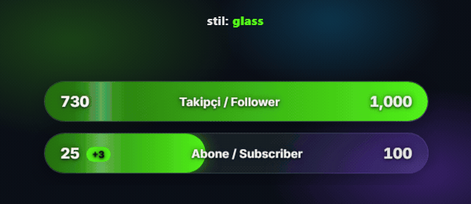
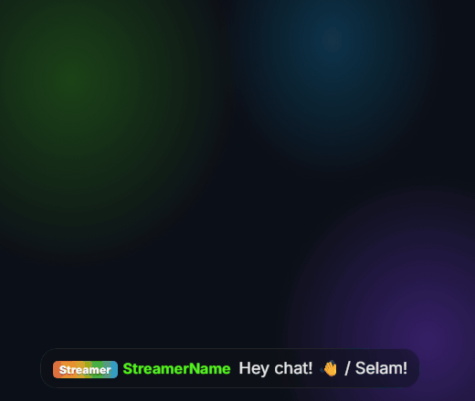
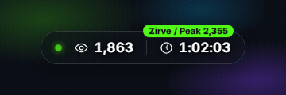
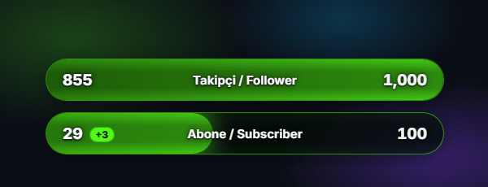

<a id="top"></a>
# Kick Streamer Overlay Pack

Free OBS overlays for [Kick](https://kick.com): goal bars, a viewer and uptime panel, a chat overlay, and a studio that writes your settings file. The basic setup needs no server and no account.

   

**Read this in:** [English](#english) · [Türkçe](#turkce)

---

<a id="english"></a>
## English

### Overview



<sub>Each theme in turn, with the live follower count of kick.com/iacbi. The bar fills, the count rises, and a light sweep crosses the fill.</sub>

Pick a look in `studio.html`, enter your channel name, and add the files to OBS as Browser sources. The overlays read Kick's public channel data directly.

| Feature | Status (checked 2026-10-16) |
|---|---|
| Follower goal | Works. The number on screen matches Kick's public count for kick.com/iacbi. |
| Viewers and uptime | Works from Kick's public data. Not yet checked on a live broadcast. |
| Subscriber total | Needs a free Kick developer app (see [Configuration](#configuration-en)). Tested against a local copy of Kick's API, not yet with a real app. Without an app, enter the count by hand. |
| Live chat | Works through the optional relay (see [Live chat](#live-chat-en)). Needs a Kick app and a public tunnel. Tested with signed test events in a real browser; not yet with live Kick delivery. Without the relay, `chat.html` stays empty instead of showing fake messages. |

### Features

- 13 themes: `glass`, `vivid`, `soft`, `cinema`, `neon`, `minimal`, `pastel`, `terminal`, `aurora`, `holo`, `ember`, `paper`, `retro`
- Corner shapes (`pill`, `rounded`, `square`), four fonts, labels in Turkish, English or both, three motion levels, and an optional percentage
- A session gain next to the subscriber count, such as "+3 this stream"
- Preview mode (`?onizleme=1`) with sample numbers and no network calls, used by the studio and these docs
- Studio with live previews, presets, a downloadable `AYARLAR.js`, and a connection test for your Kick app
- Built for OBS: animations use `transform`, `opacity` and `background-position`. The exceptions are the chat message exit and the bar fill width. Chat keeps a fixed number of messages, polls never overlap, and no Kick data is ever inserted as HTML

### Requirements

- OBS Studio with Browser sources
- A Kick channel name
- Optional: a Kick developer app (client ID and secret) for the subscriber total
- Node.js 18 or newer, for the relay and the tests
- Optional, for live chat: a tunnel tool such as `cloudflared` or `ngrok`

### Installation

1. Download this repository (or its ZIP) and keep the folder somewhere permanent.
2. Open `studio.html` in your browser. Pick a look, enter your channel name, and download `AYARLAR.js`. Put it in the folder in place of the existing file. You can also edit `AYARLAR.js` by hand.
3. In OBS, add a source with **Sources → + → Browser**, tick **Local file**, choose an overlay file, and set the width and height from the table below.
4. After you change a setting, right-click the source and choose **Refresh**.

### Usage

| File | Shows | OBS size (W × H) |
|---|---|---|
| `follower-bar.html` | Follower goal | 520 × 90 |
| `subscriber-bar.html` | Subscriber goal | 520 × 90 |
| `combined-bar.html` | Followers and subscribers in one panel | 520 × 180 |
| `info-panel.html` | Viewers and uptime, shown only while live | 300 × 80 |
| `chat.html` | Live chat (needs the relay, see Live chat) | 460 × 760 |
| `studio.html` | Configurator. Open it in a browser, not in OBS | — |

The animations below use sample numbers (`?onizleme=1`) so they show the design. The follower count in the theme animation is live data from kick.com/iacbi.

<p align="center">
  <br>
  <sub><b>Chat preview.</b> Messages arrive one by one and the feed keeps a fixed number. The crown is badge art from <code>badges/</code>.</sub>
</p>

<p align="center">
  <br>
  <sub><b>Info panel.</b> The viewer count eases up and the uptime counts every second while the channel is live.</sub>
</p>

<p align="center">
  <br>
  <sub><b>Combined panel.</b> Both goal bars fill smoothly. The chip shows how many subscribers were gained during this stream.</sub>
</p>

<sub>The chat, info panel and combined animations use sample numbers (<code>?onizleme=1</code>), so they show the design, not a live channel.</sub>

Troubleshooting:

- **`⚙ AYARLAR.js → kanal`** is shown: set `kanal` in `AYARLAR.js`, then refresh the source.
- **"Kick uygulama bilgisi hatalı"** (Kick rejected your app credentials): check `kickClientId` and `kickClientSecret` in `AYARLAR.local.js`. The studio's connection test shows the same error.
- **"Kick'e ulaşılamadı"** (Kick did not answer): the last value stays on screen and the overlay tries again.
- **Subscriber count is 0**: no Kick app is set up, so the value comes from `aboneSayisi`.

<a id="live-chat-en"></a>
#### Live chat (optional)

Kick sends chat messages and bans to a web address you register in your Kick app. The relay in `relay/` receives them, checks Kick's signature, and passes them to `chat.html`.

1. Create a Kick developer app and put its client ID and secret in `AYARLAR.local.js` (see [Configuration](#configuration-en)).
2. Start the relay and leave it running while you stream:

   ```bash
   node relay/server.js
   ```

   Set `RELAY_BROADCASTER_ID` to your channel's user ID to accept events for your channel only.
3. Make the relay's webhook port reachable from the internet with a tunnel, for example:

   ```bash
   cloudflared tunnel --url http://127.0.0.1:8788
   ```

   Use the HTTPS address the tunnel prints, with `/kick/webhook` added at the end.
4. In your Kick app settings, set that address as the webhook URL. The public Kick documentation does not say where this setting lives, so check your app's page in the developer area.
5. Subscribe to chat and bans:

   ```bash
   node relay/subscribe.js
   ```
6. Add `chat.html` in OBS as usual. Messages appear as soon as Kick delivers them.

The relay accepts only events with a valid Kick signature and shows each event once. Its overlay port listens on `127.0.0.1` only, so the tunnel exposes just the webhook path. Kick limits subscriptions per app: 10,000 per event type, and 1,000 for chat messages while the app is unverified.

<a id="configuration-en"></a>
### Configuration

Every setting lives in `AYARLAR.js`. An invalid value falls back to its default, and numbers are limited to their range.

| Setting | Values | Default |
|---|---|---|
| `kanal` | Your channel name, as in `kick.com/NAME` | *(empty)* |
| `stil` | `glass` · `vivid` · `soft` · `cinema` · `neon` · `minimal` · `pastel` · `terminal` · `aurora` · `holo` · `ember` · `paper` · `retro` | `glass` |
| `sekil` | `pill` · `rounded` · `square` | `pill` |
| `yaziTipi` | `inter` · `poppins` · `nunito` · `mono` | `inter` |
| `dil` | `tr` · `en` · `both` | `both` |
| `animasyon` | `normal` · `low` · `off` | `normal` |
| `renk` | Accent colour, hex (e.g. `#53fc18`) | `#53fc18` |
| `yayinciYazisi` | Label next to your name in chat (chat only) | `Streamer` |
| `takipciHedefi` | Follower goal | `1000` |
| `takipciYedek` | Follower count shown when Kick cannot be reached | `0` |
| `aboneHedefi` | Subscriber goal | `100` |
| `aboneSayisi` | Subscriber count when no Kick app is set up | `0` |
| `oturumFarkiGoster` | Show the gain during this stream, such as "+3" | `true` |
| `yuzdeGoster` | Show the percentage of the goal | `false` |
| `yenilemeSn` | Refresh interval in seconds (10–600) | `30` |
| `sohbetMaksMesaj` | Most chat messages on screen at once (3–20) | `8` |

**Badge art (optional).** Put an image named `moderator`, `vip`, `og`, `founder`, `verified`, `gifter` or `staff` (`.svg`, `.png`, `.webp`, `.gif`, `.jpg`) in `badges/` to replace the drawn chat badge. A missing file falls back to the drawn symbol. The five included icons are Kick's role artwork, added for convenience; replace or remove them freely (see `badges/OKU-README.txt`).

**Kick app for the subscriber total (optional)**

1. Create an app in Kick's developer area. The documentation is at [docs.kick.com](https://docs.kick.com).
2. Next to `AYARLAR.js`, create `AYARLAR.local.js`:

   ```js
   window.KICK_OVERLAY_YEREL = {
     kickClientId: "YOUR_CLIENT_ID",
     kickClientSecret: "YOUR_CLIENT_SECRET"
   };
   ```

3. Keep this file private. `.gitignore` already lists it, so Git will not track it. Do not share it or commit it.

The overlay requests and renews its own access token from `id.kick.com`. Kick documents `active_subscribers_count` for a channel but does not describe it, so use the studio's **Test connection** button to confirm the number is your subscriber total.

**Secrets and privacy.** Your client secret is read only from `AYARLAR.local.js` or the studio's memory. It is never placed in a URL, a saved draft, or the generated settings file. The overlays contact only `kick.com`, `api.kick.com`, `id.kick.com`, `files.kick.com`, and Google Fonts (`fonts.googleapis.com`, `fonts.gstatic.com`) for the typefaces. Live chat reaches the overlay from the relay on `127.0.0.1`. The relay talks only to Kick's API and its public key endpoint, and checks every webhook signature before it accepts an event.

### Contributing

- Unit tests: `node tests/run.js`, and relay tests: `node tests/relay-test.js` (Node.js 18 or newer, no packages).
- Browser tests: `node tests/e2e-chrome.js`. They need Chrome or Edge. Add `--live --channel <name>` for real Kick data, `--token` for the local mock, `--preview` for sample mode, `--perf` for a 30-second heap and DOM check, and `--relay` for live chat through the relay with signed test events.
- Pages must stay classic scripts so they work from `file://`. Use the shared `.ko-*` components and tokens in `shared/themes.css`, and prefer `transform` and `opacity` for new animations.

### License

Free for everyone, including commercial streaming. Attribution is appreciated but not required. See [LICENSE](LICENSE). This project is not affiliated with Kick.

© 2026 𝓐.𝓒.𝓑 · [kick.com/iacbi](https://kick.com/iacbi)

[⬆ Back to top](#top)

---

<a id="turkce"></a>
## Türkçe

### Genel Bakış


<sub>Her tema sırayla, kick.com/iacbi kanalının canlı takipçi sayısıyla. Çubuk dolar, sayı artar ve dolgunun üzerinden bir ışık geçer.</sub>

`studio.html` içinde bir görünüm seç, kanal adını yaz ve dosyaları OBS'ye Tarayıcı kaynağı olarak ekle. Overlay'ler Kick'in herkese açık kanal verisini doğrudan okur.

| Özellik | Durum (2026-10-16 kontrolü) |
|---|---|
| Takipçi hedefi | Çalışıyor. Ekrandaki sayı kick.com/iacbi için Kick'in herkese açık sayısıyla eşleşiyor. |
| İzleyici ve yayın süresi | Kick'in herkese açık verisinden çalışıyor. Canlı yayında henüz kontrol edilmedi. |
| Abone toplamı | Ücretsiz bir Kick geliştirici uygulaması gerektirir (bkz. [Yapılandırma](#yapilandirma-tr)). Kick API'sinin yerel bir kopyasıyla test edildi, gerçek uygulamayla henüz değil. Uygulaman yoksa sayıyı elle gir. |
| Canlı sohbet | Opsiyonel relay ile çalışıyor (bkz. [Canlı sohbet](#canli-sohbet-tr)). Bir Kick uygulaması ve herkese açık bir tünel gerektirir. Gerçek bir Kick teslimatıyla değil, imzalı test olaylarıyla gerçek bir tarayıcıda test edildi. Relay yoksa `chat.html` sahte mesaj yerine boş kalır. |

### Özellikler

- 13 tema: `glass`, `vivid`, `soft`, `cinema`, `neon`, `minimal`, `pastel`, `terminal`, `aurora`, `holo`, `ember`, `paper`, `retro`
- Köşe şekilleri (`pill`, `rounded`, `square`), dört yazı tipi, Türkçe, İngilizce ya da ikisi birden etiketler, üç hareket seviyesi ve isteğe bağlı yüzde gösterimi
- Abone sayısının yanında "bu yayında +3" gibi yayın içi artış
- Önizleme modu (`?onizleme=1`): ağ çağrısı yapmadan örnek sayılar gösterir. Stüdyo ve bu dokümantasyon kullanır.
- Canlı önizlemeli, hazır ayarlı, indirilebilir `AYARLAR.js` içeren stüdyo; Kick uygulaman için bağlantı testi
- OBS için tasarlandı: animasyonlar `transform`, `opacity` ve `background-position` kullanır. İstisnalar sohbet mesajının çıkışı ve çubuk dolgusunun genişliğidir. Sohbet sabit sayıda mesaj tutar, sorgular üst üste binmez ve Kick verisi hiçbir zaman HTML olarak eklenmez

### Gereksinimler

- Tarayıcı kaynağı destekleyen OBS Studio
- Bir Kick kanal adı
- İsteğe bağlı: abone toplamı için bir Kick geliştirici uygulaması (client ID ve client secret)
- Relay ve testler için Node.js 18 veya üstü
- Opsiyonel, canlı sohbet için: `cloudflared` veya `ngrok` gibi bir tünel aracı

### Kurulum

1. Bu depoyu indir (veya ZIP olarak al) ve klasörü kalıcı bir yere koy.
2. `studio.html` dosyasını tarayıcıda aç. Bir görünüm seç, kanal adını yaz ve `AYARLAR.js` dosyasını indir. Klasördeki mevcut dosyanın yerine koy. İstersen `AYARLAR.js` dosyasını elle de düzenleyebilirsin.
3. OBS'de **Kaynaklar → + → Tarayıcı** ile bir kaynak ekle, **Yerel dosya** kutusunu işaretle, bir overlay dosyası seç ve genişlik ile yüksekliği aşağıdaki tablodan ayarla.
4. Bir ayarı değiştirdikten sonra kaynağa sağ tıkla ve **Yenile**'yi seç.

### Kullanım

| Dosya | Gösterdiği | OBS boyutu (G × Y) |
|---|---|---|
| `follower-bar.html` | Takipçi hedefi | 520 × 90 |
| `subscriber-bar.html` | Abone hedefi | 520 × 90 |
| `combined-bar.html` | Takipçi ve aboneler tek panelde | 520 × 180 |
| `info-panel.html` | İzleyici ve yayın süresi, yalnızca yayındayken | 300 × 80 |
| `chat.html` | Canlı sohbet (relay gerektirir, bkz. Canlı sohbet) | 460 × 760 |
| `studio.html` | Yapılandırıcı. OBS'de değil, tarayıcıda aç | — |

Aşağıdaki animasyonlar tasarımı göstermek için örnek sayılar kullanır (`?onizleme=1`). Tema animasyonundaki takipçi sayısı kick.com/iacbi kanalının canlı verisidir.

<p align="center">
  <br>
  <sub><b>Sohbet önizlemesi.</b> Mesajlar teker teker gelir ve akış sabit sayıda mesaj tutar. Taç, <code>badges/</code> klasöründeki rozet görselidir.</sub>
</p>

<p align="center">
  <br>
  <sub><b>Yayın paneli.</b> İzleyici sayısı yumuşakça artar, kanal yayındayken süre her saniye ilerler.</sub>
</p>

<p align="center">
  <br>
  <sub><b>Birleşik panel.</b> İki hedef çubuğu yumuşakça dolar. Rozet, bu yayında kazanılan abone sayısını gösterir.</sub>
</p>

<sub>Sohbet, yayın paneli ve birleşik panel animasyonları örnek sayılar kullanır (<code>?onizleme=1</code>); yani canlı bir kanalı değil tasarımı gösterir.</sub>

Sorun giderme:

- **`⚙ AYARLAR.js → kanal`** yazısı görünüyorsa `AYARLAR.js` içinde `kanal` alanını doldur, sonra kaynağı yenile.
- **"Kick uygulama bilgisi hatalı"**: Kick uygulama bilgilerini reddetti. `AYARLAR.local.js` içindeki `kickClientId` ve `kickClientSecret` değerlerini kontrol et. Stüdyonun bağlantı testi aynı hatayı gösterir.
- **"Kick'e ulaşılamadı"**: Kick yanıt vermedi. Ekranda son değer kalır ve overlay yeniden dener.
- **Abone sayısı 0**: Kick uygulaması kurulu değil, değer `aboneSayisi` alanından gelir.

<a id="canli-sohbet-tr"></a>
#### Canlı sohbet (opsiyonel)

Kick, sohbet mesajlarını ve yasakları, Kick uygulamanda kayıtlı bir web adresine gönderir. `relay/` klasöründeki relay bunları alır, Kick'in imzasını doğrular ve `chat.html`'e iletir.

1. Bir Kick geliştirici uygulaması oluştur ve client ID ile secret değerlerini `AYARLAR.local.js` dosyasına ekle (bkz. [Yapılandırma](#yapilandirma-tr)).
2. Relay'i başlat ve yayın sırasında açık bırak:

   ```bash
   node relay/server.js
   ```

   Yalnızca kendi kanalının olaylarını kabul etmek için `RELAY_BROADCASTER_ID` değerine kanalının kullanıcı kimliğini yaz.
3. Relay'in webhook portunu bir tünelle internete aç, örneğin:

   ```bash
   cloudflared tunnel --url http://127.0.0.1:8788
   ```

   Tünelin verdiği HTTPS adresinin sonuna `/kick/webhook` ekle.
4. Kick uygulama ayarlarında bu adresi webhook URL'si olarak gir. Kick'in herkese açık dokümantasyonu bu ayarın yerini belirtmiyor; geliştirici alanındaki uygulama sayfanda kontrol et.
5. Sohbet ve yasak olaylarına abone ol:

   ```bash
   node relay/subscribe.js
   ```
6. `chat.html` dosyasını OBS'ye her zamanki gibi ekle. Mesajlar Kick teslim eder etmez görünür.

Relay yalnızca geçerli Kick imzası taşıyan olayları kabul eder ve her olayı bir kez gösterir. Overlay portu yalnızca `127.0.0.1`'de dinler; tünel sadece webhook yolunu dışarı açar. Kick, uygulama başına abonelikleri sınırlar: olay türü başına 10.000, doğrulanmamış uygulamada sohbet mesajları için 1.000.

<a id="yapilandirma-tr"></a>
### Yapılandırma

Tüm ayarlar `AYARLAR.js` içindedir. Geçersiz bir değer varsayılanına döner, sayılar kendi aralıklarına sınırlanır.

| Ayar | Değerler | Varsayılan |
|---|---|---|
| `kanal` | Kick kanal adın, `kick.com/ADIN` içindeki gibi | *(boş)* |
| `stil` | `glass` · `vivid` · `soft` · `cinema` · `neon` · `minimal` · `pastel` · `terminal` · `aurora` · `holo` · `ember` · `paper` · `retro` | `glass` |
| `sekil` | `pill` · `rounded` · `square` | `pill` |
| `yaziTipi` | `inter` · `poppins` · `nunito` · `mono` | `inter` |
| `dil` | `tr` · `en` · `both` | `both` |
| `animasyon` | `normal` · `low` · `off` | `normal` |
| `renk` | Vurgu rengi, hex (ör. `#53fc18`) | `#53fc18` |
| `yayinciYazisi` | Sohbette senin adının yanındaki etiket (yalnızca sohbet) | `Streamer` |
| `takipciHedefi` | Takipçi hedefi | `1000` |
| `takipciYedek` | Kick'e ulaşılamadığında gösterilecek takipçi sayısı | `0` |
| `aboneHedefi` | Abone hedefi | `100` |
| `aboneSayisi` | Kick uygulaması kurulu değilken gösterilecek abone sayısı | `0` |
| `oturumFarkiGoster` | Bu yayındaki artışı göster, ör. "+3" | `true` |
| `yuzdeGoster` | Hedefin yüzdesini göster | `false` |
| `yenilemeSn` | Yenileme aralığı, saniye (10–600) | `30` |
| `sohbetMaksMesaj` | Ekranda aynı anda en fazla sohbet mesajı (3–20) | `8` |

**Rozet görselleri (isteğe bağlı).** `badges/` klasörüne `moderator`, `vip`, `og`, `founder`, `verified`, `gifter` veya `staff` adıyla bir görsel (`.svg`, `.png`, `.webp`, `.gif`, `.jpg`) koyarsan çizili sohbet rozetinin yerine geçer. Dosya yoksa çizili simge gösterilir. Pakete eklenen beş ikon Kick'in rol görselleridir, kolaylık için eklenmiştir; istediğin gibi değiştirebilir veya kaldırabilirsin (bkz. `badges/OKU-README.txt`).

**Abone toplamı için Kick uygulaması (isteğe bağlı)**

1. Kick'in geliştirici alanında bir uygulama oluştur. Dokümantasyon [docs.kick.com](https://docs.kick.com) adresinde.
2. `AYARLAR.js` ile aynı klasörde `AYARLAR.local.js` dosyası oluştur:

   ```js
   window.KICK_OVERLAY_YEREL = {
     kickClientId: "CLIENT_ID_BURAYA",
     kickClientSecret: "CLIENT_SECRET_BURAYA"
   };
   ```

3. Bu dosyayı gizli tut. `.gitignore` onu zaten listeler, Git takip etmez. Kimseyle paylaşma, commit etme.

Overlay, erişim anahtarını `id.kick.com` üzerinden kendisi alır ve yeniler. Kick, kanal için `active_subscribers_count` alanını belgeler ama açıklamaz. Sayının gerçekten abone toplamın olduğunu stüdyodaki **Bağlantıyı test et** düğmesiyle doğrula.

**Gizli bilgiler ve gizlilik.** Client secret yalnızca `AYARLAR.local.js` dosyasından ya da stüdyonun belleğinden okunur. Hiçbir zaman bir URL'ye, kaydedilmiş taslağa ya da üretilen ayar dosyasına konmaz. Overlay'ler yalnızca `kick.com`, `api.kick.com`, `id.kick.com`, `files.kick.com` ve yazı tipleri için Google Fonts'a (`fonts.googleapis.com`, `fonts.gstatic.com`) bağlanır. Canlı sohbet, relay üzerinden `127.0.0.1`'den gelir. Relay yalnızca Kick'in API'sine ve açık anahtar uç noktasına bağlanır ve her webhook imzasını kabul etmeden önce doğrular.

### Katkı

- Birim testleri: `node tests/run.js`, relay testleri: `node tests/relay-test.js` (Node.js 18 veya üstü, paket gerekmez).
- Tarayıcı testleri: `node tests/e2e-chrome.js`. Chrome veya Edge gerekir. Gerçek Kick verisi için `--live --channel <ad>`, yerel sahte sunucu için `--token`, önizleme modu için `--preview`, 30 saniyelik bellek ve DOM kontrolü için `--perf`, imzalı test olaylarıyla relay üzerinden canlı sohbet için `--relay` ekle.
- Sayfalar `file://` üzerinden çalışabilmek için klasik script olarak kalmalı. Ortak `.ko-*` bileşenlerini ve `shared/themes.css` içindeki değişkenleri kullan, yeni animasyonlar için `transform` ve `opacity` tercih et.

### Lisans

Ticari yayın dahil herkes için ücretsiz. Kaynak göstermek hoş karşılanır ama zorunlu değildir. Ayrıntılar için [LICENSE](LICENSE). Bu proje Kick ile bağlantılı değildir.

© 2026 𝓐.𝓒.𝓑 · [kick.com/iacbi](https://kick.com/iacbi)

[⬆ Başa Dön](#top)
