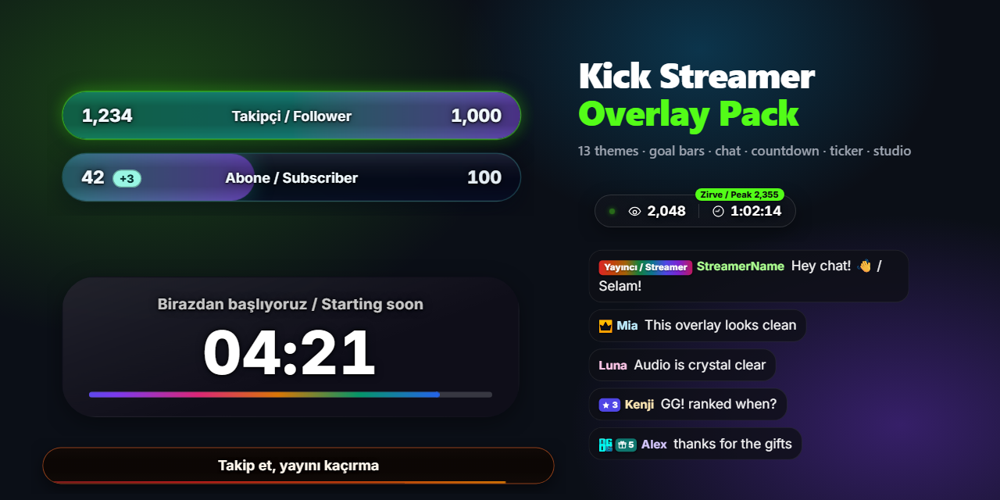
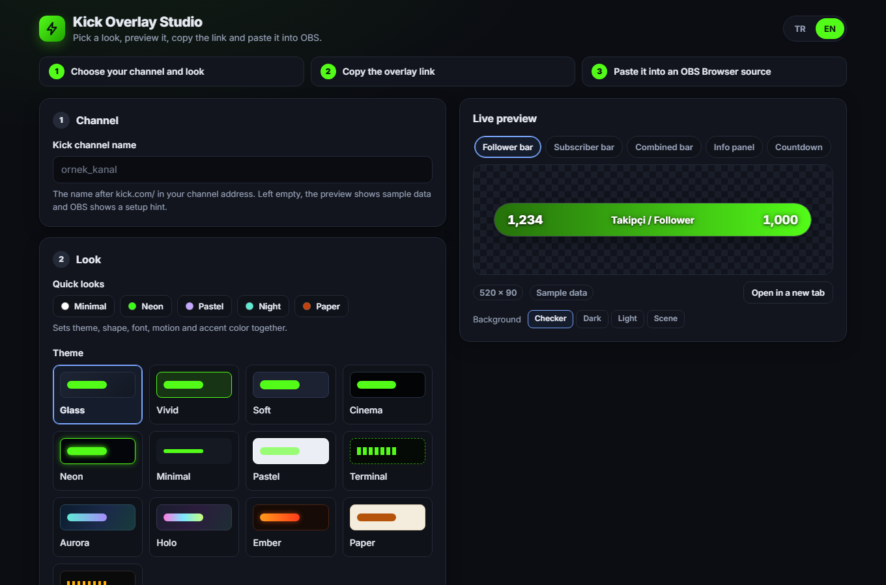
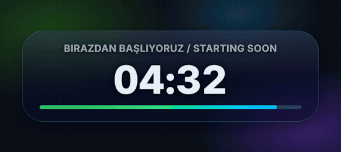
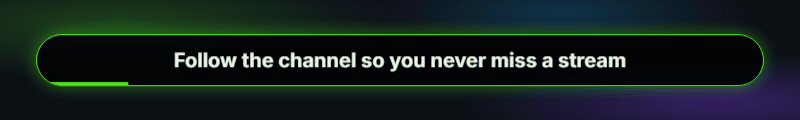
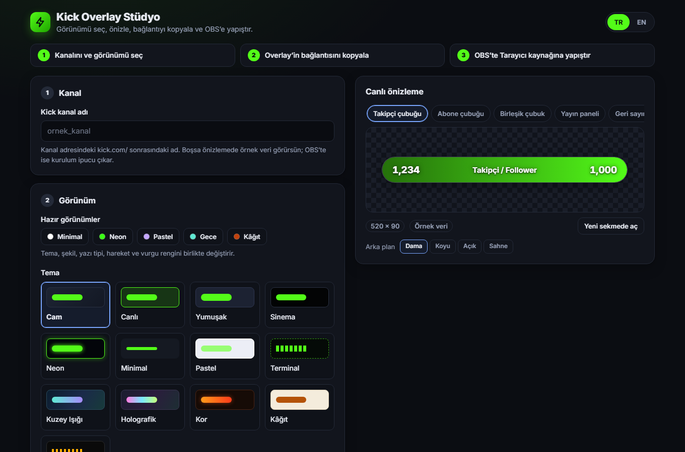

<a id="top"></a>
# Kick Streamer Overlay Pack

Free OBS overlays for [Kick](https://kick.com): goal bars, a viewer and uptime panel, a chat overlay, a "starting soon" countdown, a rotating announcement bar, and a studio that gives you a ready link for each overlay. The basic setup needs no server and no account.

[](https://github.com/IACBI/kick-streamer-overlays/actions/workflows/ci.yml)     

<p align="center"></p>

**Read this in:** [English](#english) · [Türkçe](#turkce)

---

<a id="english"></a>
## English

### Overview


<sub>Each of the 13 themes in turn, with sample numbers. The bars fill and a light sweep crosses the fill.</sub>

Open `studio.html`, enter your channel name, pick a look, and copy the link of each overlay into an OBS Browser source. The overlays read Kick's public channel data directly. If the optional relay is running, they ask it first instead. The relay keeps the answers for a few seconds, so several overlays share one request to Kick.

<p align="center"></p>

| Feature | Status (checked 2026-10-16) |
|---|---|
| Follower goal | Works. The number on screen matches Kick's public count for kick.com/iacbi. |
| Viewers and uptime | Works from Kick's public data. Not yet checked on a live broadcast. |
| Subscriber total | Needs a free Kick developer app (see [Configuration](#configuration-en)). Tested against a local copy of Kick's API, not yet with a real app. Without an app, enter the count by hand. |
| Live chat | Works through the optional relay (see [Live chat](#live-chat-en)). Needs a Kick app and a public tunnel. Tested with signed test events in a real browser; not yet with live Kick delivery. Without the relay, `chat.html` stays empty instead of showing fake messages. |

### Features

- 13 themes: `glass`, `vivid`, `soft`, `cinema`, `neon`, `minimal`, `pastel`, `terminal`, `aurora`, `holo`, `ember`, `paper`, `retro`
- Corner shapes (`pill`, `rounded`, `square`), four fonts (only the one you pick is loaded), labels in Turkish, English or both, three motion levels, and an optional percentage. Reduced-motion settings are respected everywhere
- A session gain next to the subscriber count, such as "+3 this stream". It survives an OBS refresh for 12 hours
- Goal bars pulse at 25, 50 and 75 %, and show a goal-reached state at 100 % (`hedefKutlama`)
- A countdown to a length in minutes or to a clock time (`geriSayimSaat`), and an announcement bar that rotates your lines. Both work without any Kick data
- Chat filters: hide `!` commands and named users such as bots, and fade messages out after a set time
- An info panel with viewers, uptime and peak viewers
- Preview mode (`?onizleme=1`) with sample numbers and no network calls, and a status box with `?debug=1`
- Studio in Turkish and English: live preview with a tab per overlay, quick looks, a copy-link button for each overlay or all of them, JSON export and import of the look (credentials are never included), the `AYARLAR.js` file as an alternative, a relay check, and a connection test for your Kick app
- Built for OBS: animations use `transform` and `opacity`. Polls back off when Kick is slow or limits requests, pause while the page is hidden, and never overlap. Chat reconnects by itself, and no Kick data is ever inserted as HTML

### Requirements

- OBS Studio with Browser sources
- A Kick channel name
- Optional: a Kick developer app (client ID and secret) for the subscriber total
- Node.js 20 or newer, for the relay and the tests
- Optional, for live chat: a tunnel tool such as `cloudflared` or `ngrok`

### Installation

1. Download this repository (or its ZIP) and keep the folder somewhere permanent.
2. Open `studio.html` in your browser. Enter your channel name and pick a look.
3. In the studio's **Add to OBS** step, press **Copy link** on the overlay you want. In OBS add a source with **Sources → + → Browser**, turn **Local file** off, paste the link into **URL**, and set the width and height shown on the card (they are also in the table below).
4. After you change a setting in the studio, copy the link again and paste it into the source.

Prefer OBS's **Local file** option? Open the studio's **Settings file method**, download `AYARLAR.js`, put it in the project folder in place of the existing file, tick **Local file** in OBS, and choose the overlay file. After a change, right-click the source and choose **Refresh**. You can also edit `AYARLAR.js` by hand.

A link holds only your public settings, never your Kick app credentials. The subscriber total reads them from `AYARLAR.local.js` (or from the relay, see [Relay](#relay-en)).

### Usage

| File | Shows | OBS size (W × H) |
|---|---|---|
| `follower-bar.html` | Follower goal | 520 × 90 |
| `subscriber-bar.html` | Subscriber goal | 520 × 90 |
| `combined-bar.html` | Followers and subscribers in one panel | 520 × 180 |
| `info-panel.html` | Viewers and uptime, shown only while live | 300 × 80 |
| `chat.html` | Live chat (needs the relay, see Live chat) | 460 × 760 |
| `countdown.html` | "Starting soon" countdown that starts when the source loads | 520 × 190 |
| `ticker.html` | Announcement bar that rotates your lines | 760 × 80 |
| `studio.html` | Studio: previews, settings and links. Open it in a browser, not in OBS | — |

These previews use sample data (`?onizleme=1`), so they show the design and make no request to Kick.

<p align="center">
  <br>
  <sub><b>Chat preview.</b> Messages arrive one by one and the feed keeps a fixed number. The crown is badge art from <code>badges/</code>.</sub>
</p>

<p align="center">
  <br>
  <sub><b>Info panel.</b> The viewer count eases up and the uptime counts every second while the channel is live.</sub>
</p>

<p align="center">
  <br>
  <sub><b>Combined panel.</b> Both goal bars fill smoothly. The chip shows how many subscribers were gained during this stream.</sub>
</p>

<p align="center">
  <br>
  <sub><b>Countdown.</b> Put it on your "starting soon" scene. The clock starts when the source loads, so refreshing the source restarts it. At zero it shows "Going live!".</sub>
</p>

<p align="center">
  <br>
  <sub><b>Announcement bar.</b> Your lines rotate with a soft transition. A thin line shows when the next one arrives.</sub>
</p>

Troubleshooting. Messages appear in the language set by `dil`: Turkish, English, or both.

- **`⚙ AYARLAR.js → kanal`** is shown: enter your channel name in the studio and copy the link again (or set `kanal` in `AYARLAR.js` and refresh the source).
- **Kick app credentials rejected**: check `kickClientId` and `kickClientSecret` in `AYARLAR.local.js`. The studio's connection test shows the same error.
- **Kick unreachable** or **Kick error, showing last value**: the last value stays on screen and the overlay tries again, waiting longer after each failure.
- **Kick rate limit, showing last value**: Kick asked the overlay to slow down. It waits for the time Kick gave and then carries on.
- **Chat relay not running** (`chat.html`): start the relay (`node relay/server.js`). Until then the chat stays empty.
- **No subscriber data**: the Kick app answered without a subscriber figure for this channel.
- **Subscriber count is 0**: no Kick app is set up, so the value comes from `aboneSayisi`.
- **The countdown restarted**: it counts from the moment the source loads. Refreshing the source, or switching scenes with *Shutdown source when not visible* on, starts it again.
- **`⚙ AYARLAR.js → duyuruMetinleri`** on the announcement bar: fill in `duyuruMetinleri`, then refresh the source.
- **Anything else**: add `?debug=1` to the link. A small box at the bottom left shows the data source, the status, the last poll and the next one. Remove the parameter when you are done.

<a id="live-chat-en"></a>
#### Live chat (optional)

Kick sends chat messages and bans to a web address you register in your Kick app. The relay in `relay/` receives them, checks Kick's signature, and passes them to `chat.html`.

1. Create a Kick developer app. Put its client ID and secret in `AYARLAR.local.js` (see [Configuration](#configuration-en)), or in the environment as `KICK_CLIENT_ID` and `KICK_CLIENT_SECRET`.
2. Let the relay know your channel. It looks up your broadcaster ID from `kanal` in `AYARLAR.js` (or from `KICK_CHANNEL`) when it starts. If you already know the ID, set `RELAY_BROADCASTER_ID` instead and the lookup is skipped.
3. Start the relay and leave it running while you stream:

   ```bash
   node relay/server.js
   ```
4. Make the relay's webhook port reachable from the internet with a tunnel, for example:

   ```bash
   cloudflared tunnel --url http://127.0.0.1:8788
   ```

   Use the HTTPS address the tunnel prints, with `/kick/webhook` added at the end.
5. Go to [kick.com/settings/developer](https://kick.com/settings/developer), click **Edit** on your app, turn on **Enable Webhooks**, and paste the address into the **Webhook URL** box. Kick's [event introduction](https://github.com/KickEngineering/KickDevDocs/blob/main/events/introduction.md) describes these steps.
6. Subscribe to chat and bans:

   ```bash
   node relay/subscribe.js
   ```
7. Add `chat.html` in OBS as usual. Messages appear as soon as Kick delivers them.

The relay accepts only events with a valid Kick signature, passes each one on only once, and passes on chat and bans only for your broadcaster ID. While that ID is unknown, events are dropped and the relay says so in its log; it retries the lookup at most once a minute. Its overlay port listens on `127.0.0.1` only and refuses requests with a foreign `Host` header, so the tunnel exposes just the webhook path. Kick limits subscriptions per app: 10,000 per event type, and 1,000 for chat messages while the app is unverified.

<a id="relay-en"></a>
#### Relay: endpoints and subscriber total (optional)

The relay is one small Node.js program with no packages. It has two listeners, both bound to `127.0.0.1`. The webhook port (8788 by default) takes Kick's events on `POST /kick/webhook`, and is the only path meant for a tunnel. The overlay port (8790 by default) serves the overlays:

| Endpoint | Answer |
|---|---|
| `GET /events` | Server-sent events: `chat` and `ban` messages for `chat.html`. |
| `GET /health` | The relay version, the number of open event streams, and what it can do: `chat`, `channel` and `subscribers`. |
| `GET /channel?slug=NAME` | Kick's public channel data, cached for 20 seconds. The `X-Kick-Source` header says whether it came from Kick's v2 or v1 API. |
| `GET /subscribers?slug=NAME` | Your subscriber total from Kick's official API, using the app credentials the relay holds. Cached for 15 seconds. Returns `subs`, `gifted`, `canceled`, `live`, `viewers`, `startMs` and `title`. |

When Kick limits the relay, it answers `429` with `Retry-After`. Without credentials `/subscribers` answers `503`, and a rejected login answers `401`.

The subscriber bars need no client secret in the browser when the relay runs. Put the app credentials in `AYARLAR.local.js` or the environment and start the relay. The bars then get the total from `/subscribers`, and the page sends no request to Kick itself. If the relay is not running, the bars use `AYARLAR.local.js` directly. If that is missing too, they show `aboneSayisi`.

The relay reads these environment variables. Each has a default, and the settings files are used when a variable is not set:

| Variable | Default | Purpose |
|---|---|---|
| `KICK_CLIENT_ID`, `KICK_CLIENT_SECRET` | from `AYARLAR.local.js` | Kick app credentials. The environment wins. |
| `KICK_CHANNEL` | `kanal` in `AYARLAR.js` | Channel used for the broadcaster lookup. |
| `RELAY_BROADCASTER_ID` | looked up | Your broadcaster user ID. Skips the lookup. |
| `RELAY_ALLOW_ANY_BROADCASTER` | off | `1` accepts chat and bans from any channel. For testing only. |
| `RELAY_WEBHOOK_PORT` | `8788` | Webhook port. |
| `RELAY_EVENTS_PORT` | `8790` | Overlay port. If you change it, set `relayAdresi` to match. |

<a id="configuration-en"></a>
### Configuration

Every setting lives in `AYARLAR.js`, and the studio writes the same settings into the links it gives you. A link overrides `AYARLAR.js`. An invalid value falls back to its default, and numbers are limited to their range. Yes/no settings accept `true`/`false`, `yes`/`no`, `on`/`off` or `1`/`0`.

| Setting | Values | Default |
|---|---|---|
| `kanal` | Your channel name, as in `kick.com/NAME`. A full kick.com link or `@NAME` also works | *(empty)* |
| `stil` | `glass` · `vivid` · `soft` · `cinema` · `neon` · `minimal` · `pastel` · `terminal` · `aurora` · `holo` · `ember` · `paper` · `retro` | `glass` |
| `sekil` | `pill` · `rounded` · `square` | `pill` |
| `yaziTipi` | `inter` · `poppins` · `nunito` · `mono` | `inter` |
| `dil` | `tr` · `en` · `both` | `both` |
| `animasyon` | `normal` · `low` · `off` | `normal` |
| `renk` | Accent color, hex (e.g. `#53fc18`) | `#53fc18` |
| `yayinciYazisi` | Label next to your name in chat (chat only) | `Streamer` |
| `takipciHedefi` | Follower goal | `1000` |
| `takipciYedek` | Follower count shown when Kick cannot be reached | `0` |
| `aboneHedefi` | Subscriber goal | `100` |
| `aboneSayisi` | Subscriber count when no Kick app is set up | `0` |
| `oturumFarkiGoster` | Show the gain during this stream, such as "+3" | `true` |
| `yuzdeGoster` | Show the percentage of the goal | `false` |
| `hedefKutlama` | Milestone pulse at 25, 50 and 75 %, and a goal-reached state at 100 % | `true` |
| `hataNotu` | Show the small status note on screen, such as "Kick unreachable" | `true` |
| `yenilemeSn` | Refresh interval in seconds (10–600) | `30` |
| `sohbetMaksMesaj` | Most chat messages on screen at once (3–20) | `8` |
| `sohbetKomutGizle` | Hide chat messages that start with `!` | `false` |
| `sohbetGizliKullanicilar` | Usernames hidden from chat, comma-separated, not case-sensitive (up to 300 characters) | *(empty)* |
| `sohbetSilinmeSn` | Seconds before a chat message fades out (0–600). `0` keeps it until newer messages push it out | `0` |
| `geriSayimDk` | Countdown length in minutes (1–720) | `5` |
| `geriSayimSaat` | Countdown target as a 24-hour clock time, `HH:MM` (e.g. `20:30`). Overrides `geriSayimDk`; if the time has already passed today, it counts to tomorrow | *(empty)* |
| `geriSayimBaslik` | Countdown title. Empty shows "Starting soon" in your label language | *(empty)* |
| `duyuruMetinleri` | Announcement lines separated by `\|`, up to 12, e.g. `Follow for more \| !discord \| New video every Friday` | *(empty)* |
| `duyuruSn` | Seconds each announcement stays (3–60) | `6` |

Settings that are only for the local machine. They are never read from a link:

| Key | Where | Default | Purpose |
|---|---|---|---|
| `kickClientId`, `kickClientSecret` | `AYARLAR.local.js` | *(empty)* | Kick app credentials for the subscriber bars. The relay reads them too. |
| `relayAdresi` | `AYARLAR.js` | `http://127.0.0.1:8790` | Address of the relay's overlay port. Only `https`, or `http` on `127.0.0.1` or `localhost`, is accepted. |
| `apiBase`, `tokenBase` | `AYARLAR.js` | `https://api.kick.com`, `https://id.kick.com` | Kick API addresses used by the subscriber bars. Leave them alone unless you test against a mirror. |

**Upgrading from 2.2.x.** `AYARLAR.local.js` is now loaded only by `subscriber-bar.html` and `combined-bar.html`. If you set `relayAdresi` in that file, move it to `AYARLAR.js`. The relay still reads the credentials from `AYARLAR.local.js`.

**Badge art (optional).** Put an image named `moderator`, `vip`, `og`, `founder`, `verified`, `gifter` or `staff` (`.svg`, `.png`, `.webp`, `.gif`, `.jpg`, `.jpeg`) in `badges/` to replace the drawn chat badge. A missing file falls back to the drawn symbol. The five included icons are Kick's role artwork, added for convenience; replace or remove them freely (see `badges/OKU-README.txt`).

**Kick app for the subscriber total (optional)**

1. Create an app in Kick's developer area. The documentation is at [docs.kick.com](https://docs.kick.com).
2. Next to `AYARLAR.js`, create `AYARLAR.local.js`:

   ```js
   window.KICK_OVERLAY_YEREL = {
     kickClientId: "YOUR_CLIENT_ID",
     kickClientSecret: "YOUR_CLIENT_SECRET"
   };
   ```

3. Keep this file private. `.gitignore` already lists it, so Git will not track it. Do not share it or commit it.

Without the relay, the subscriber bars request and renew their own access token from `id.kick.com`. With the relay running, they ask the relay instead (see [Relay](#relay-en)). Kick lists `active_subscribers_count` for a channel but does not explain it, so use the studio's **Test connection** button to confirm the number is your subscriber total.

**Secrets and privacy.** Your client secret is read only from `AYARLAR.local.js`, from the `KICK_CLIENT_SECRET` environment variable, or from the studio's memory. It is never placed in a link, a saved draft, the JSON export or the generated settings file. In the browser, only `subscriber-bar.html` and `combined-bar.html` read it. The overlays contact `kick.com` (channel data), `api.kick.com` and `id.kick.com` (subscriber total, only with your app), `files.kick.com` (chat emotes), and Google Fonts (`fonts.googleapis.com`, `fonts.gstatic.com`) for the one typeface you pick. Live chat and relay answers come from `127.0.0.1`. The relay talks only to Kick, and checks every webhook signature before it accepts an event. [SECURITY.md](SECURITY.md) describes the full model.

### Contributing

- Unit tests: `node tests/run.js`. Relay tests: `node tests/relay-test.js`. Both need Node.js 20 or newer and no packages, and `npm test` runs them together. GitHub Actions runs a syntax check and both suites on Node.js 20, 22 and 24, on Ubuntu and Windows, for every push to `main` and every pull request.
- Browser tests: `node tests/e2e-chrome.js`. They need Chrome or Edge. Add `--live --channel <name>` for real Kick data, `--token` for the local mock, `--preview` for sample mode, `--perf` for a 30-second heap and DOM check, and `--relay` for live chat through the relay with signed test events.
- The studio keeps all its texts in one Turkish and English table. A new setting needs an entry in both languages.
- Pages must stay classic scripts so they work from `file://`. Use the shared `.ko-*` components and tokens in `shared/themes.css`, and prefer `transform` and `opacity` for new animations.
- `node tools/record-previews.js` re-creates the images in `screenshots/` (needs Node.js 22 or newer, Chrome or Edge, and `ffmpeg`).
- More in [CONTRIBUTING.md](CONTRIBUTING.md), [SECURITY.md](SECURITY.md) and the [changelog](CHANGELOG.md).

### License

Free for everyone, including commercial streaming. Attribution is appreciated but not required. See [LICENSE](LICENSE). This project is not affiliated with Kick.

© 2026 𝓐.𝓒.𝓑 · [kick.com/iacbi](https://kick.com/iacbi)

[⬆ Back to top](#top)

---

<a id="turkce"></a>
## Türkçe

### Genel Bakış


<sub>13 temanın her biri sırayla, örnek sayılarla. Çubuklar dolar ve dolgunun üzerinden bir ışık geçer.</sub>

`studio.html` dosyasını aç, kanal adını yaz, bir görünüm seç ve her overlay'in bağlantısını OBS'te bir Tarayıcı kaynağına yapıştır. Overlay'ler Kick'in herkese açık kanal verisini doğrudan okur. İsteğe bağlı relay çalışıyorsa önce ondan ister. Relay yanıtları birkaç saniye saklar; böylece birden çok overlay Kick'e tek bir istek paylaşır.

<p align="center"></p>

| Özellik | Durum (2026-10-16 kontrolü) |
|---|---|
| Takipçi hedefi | Çalışıyor. Ekrandaki sayı kick.com/iacbi için Kick'in herkese açık sayısıyla eşleşiyor. |
| İzleyici ve yayın süresi | Kick'in herkese açık verisinden çalışıyor. Canlı yayında henüz kontrol edilmedi. |
| Abone toplamı | Ücretsiz bir Kick geliştirici uygulaması gerektirir (bkz. [Yapılandırma](#yapilandirma-tr)). Kick API'sinin yerel bir kopyasıyla test edildi, gerçek uygulamayla henüz değil. Uygulaman yoksa sayıyı elle gir. |
| Canlı sohbet | Opsiyonel relay ile çalışıyor (bkz. [Canlı sohbet](#canli-sohbet-tr)). Bir Kick uygulaması ve herkese açık bir tünel gerektirir. Gerçek bir Kick teslimatıyla değil, imzalı test olaylarıyla gerçek bir tarayıcıda test edildi. Relay yoksa `chat.html` sahte mesaj yerine boş kalır. |

### Özellikler

- 13 tema: `glass`, `vivid`, `soft`, `cinema`, `neon`, `minimal`, `pastel`, `terminal`, `aurora`, `holo`, `ember`, `paper`, `retro`
- Köşe şekilleri (`pill`, `rounded`, `square`), dört yazı tipi (yalnızca seçtiğin yüklenir), Türkçe, İngilizce ya da ikisi birden etiketler, üç hareket seviyesi ve isteğe bağlı yüzde gösterimi. Hareket azaltma ayarları her yerde geçerlidir
- Abone sayısının yanında "bu yayında +3" gibi yayın içi artış. OBS'te kaynağı yenilesen de 12 saat boyunca korunur
- Hedef çubukları yüzde 25, 50 ve 75'te nabız atar, yüzde 100'de "hedefe ulaşıldı" durumuna geçer (`hedefKutlama`)
- Dakika cinsinden ya da saat olarak (`geriSayimSaat`) geri sayım ve satırlarını döndüren duyuru çubuğu. İkisi de Kick verisi olmadan çalışır
- Sohbet filtreleri: `!` ile başlayan komutları ve bot gibi adı verilen kullanıcıları gizle, mesajları belli bir süre sonra soluklaştır
- İzleyici, yayın süresi ve en yüksek izleyici sayısını gösteren bir yayın paneli
- Önizleme modu (`?onizleme=1`): ağ çağrısı yapmadan örnek sayılar gösterir. `?debug=1` ile küçük bir durum kutusu açılır
- Türkçe ve İngilizce stüdyo: her overlay için sekmeli canlı önizleme, hazır görünümler, her overlay için ya da hepsi için bağlantı kopyalama, görünümü JSON olarak dışa ve içe aktarma (kimlik bilgileri hiçbir zaman dahil edilmez), alternatif olarak `AYARLAR.js` dosyası, relay denetimi ve Kick uygulaman için bağlantı testi
- OBS için tasarlandı: animasyonlar `transform` ve `opacity` kullanır. Kick yavaşladığında ya da istek sınırı koyduğunda sorgular geri çekilir, sayfa gizliyken durur ve hiçbir zaman üst üste binmez. Sohbet kendiliğinden yeniden bağlanır; Kick verisi hiçbir zaman HTML olarak eklenmez

### Gereksinimler

- Tarayıcı kaynağı destekleyen OBS Studio
- Bir Kick kanal adı
- İsteğe bağlı: abone toplamı için bir Kick geliştirici uygulaması (client ID ve client secret)
- Relay ve testler için Node.js 20 veya üstü
- Opsiyonel, canlı sohbet için: `cloudflared` veya `ngrok` gibi bir tünel aracı

### Kurulum

1. Bu depoyu indir (veya ZIP olarak al) ve klasörü kalıcı bir yere koy.
2. `studio.html` dosyasını tarayıcıda aç. Kanal adını yaz ve bir görünüm seç.
3. Stüdyonun **OBS'e ekle** adımında istediğin overlay'in **Bağlantıyı kopyala** düğmesine bas. OBS'te **Kaynaklar → + → Tarayıcı** ile bir kaynak ekle, **Yerel dosya** kutusunu kapat, bağlantıyı **URL** kutusuna yapıştır ve genişlik ile yüksekliği kartta yazan boyuta ayarla (aşağıdaki tabloda da var).
4. Stüdyoda bir ayarı değiştirdikten sonra bağlantıyı yeniden kopyalayıp kaynağa yapıştır.

OBS'in **Yerel dosya** seçeneğini mi tercih edersin? Stüdyodaki **Ayar dosyası yöntemi** bölümünden `AYARLAR.js` dosyasını indir, proje klasöründeki dosyanın yerine koy, OBS'te **Yerel dosya** kutusunu işaretle ve overlay dosyasını seç. Değişiklikten sonra kaynağa sağ tıklayıp **Yenile**'yi seç. `AYARLAR.js` dosyasını elle de düzenleyebilirsin.

Bağlantı yalnızca herkese açık ayarlarını taşır, Kick uygulaman bilgilerini asla. Abone toplamı bu bilgileri `AYARLAR.local.js` dosyasından (ya da relay üzerinden, bkz. [Relay](#relay-tr)) okur.

### Kullanım

| Dosya | Gösterdiği | OBS boyutu (G × Y) |
|---|---|---|
| `follower-bar.html` | Takipçi hedefi | 520 × 90 |
| `subscriber-bar.html` | Abone hedefi | 520 × 90 |
| `combined-bar.html` | Takipçi ve aboneler tek panelde | 520 × 180 |
| `info-panel.html` | İzleyici ve yayın süresi, yalnızca yayındayken | 300 × 80 |
| `chat.html` | Canlı sohbet (relay gerektirir, bkz. Canlı sohbet) | 460 × 760 |
| `countdown.html` | Kaynak yüklenince başlayan "birazdan başlıyoruz" geri sayımı | 520 × 190 |
| `ticker.html` | Satırlarını sırayla gösteren duyuru çubuğu | 760 × 80 |
| `studio.html` | Stüdyo: önizleme, ayarlar ve bağlantılar. OBS'de değil, tarayıcıda aç | — |

Buradaki tüm animasyonlar örnek veri kullanır (`?onizleme=1`); yani tasarımı gösterir ve Kick'e istek yapmaz.

<p align="center">
  <br>
  <sub><b>Sohbet önizlemesi.</b> Mesajlar teker teker gelir ve akış sabit sayıda mesaj tutar. Taç, <code>badges/</code> klasöründeki rozet görselidir.</sub>
</p>

<p align="center">
  <br>
  <sub><b>Yayın paneli.</b> İzleyici sayısı yumuşakça artar, kanal yayındayken süre her saniye ilerler.</sub>
</p>

<p align="center">
  <br>
  <sub><b>Birleşik panel.</b> İki hedef çubuğu yumuşakça dolar. Rozet, bu yayında kazanılan abone sayısını gösterir.</sub>
</p>

<p align="center">
  <br>
  <sub><b>Geri sayım.</b> "Birazdan başlıyoruz" sahnene koy. Saat kaynak yüklenince başlar; kaynağı yenilersen yeniden başlar. Sıfırda "Başlıyoruz!" yazar.</sub>
</p>

<p align="center">
  <br>
  <sub><b>Duyuru çubuğu.</b> Satırların yumuşak bir geçişle döner. İnce bir çizgi bir sonrakinin ne zaman geleceğini gösterir.</sub>
</p>

Sorun giderme. Mesajlar `dil` ayarındaki dilde görünür: Türkçe, İngilizce ya da ikisi birden.

- **`⚙ AYARLAR.js → kanal`** yazısı görünüyorsa stüdyoda kanal adını yaz ve bağlantıyı yeniden kopyala (ya da `AYARLAR.js` içinde `kanal` alanını doldurup kaynağı yenile).
- **Kick uygulama bilgisi hatalı**: Kick uygulama bilgilerini reddetti. `AYARLAR.local.js` içindeki `kickClientId` ve `kickClientSecret` değerlerini kontrol et. Stüdyonun bağlantı testi aynı hatayı gösterir.
- **Kick'e ulaşılamıyor** ya da **Kick yanıt vermedi, son değer**: Ekranda son değer kalır, overlay yeniden dener ve her hatadan sonra biraz daha uzun bekler.
- **Kick istek sınırı, son değer**: Kick overlay'den yavaşlamasını istedi. Kick'in verdiği süre kadar bekler, sonra devam eder.
- **Relay çalışmıyor** (`chat.html`): relay'i başlat (`node relay/server.js`). Başlatana kadar sohbet kutusu boş kalır.
- **Abone verisi yok**: Kick uygulaması yanıt verdi ama bu kanal için bir abone sayısı döndürmedi.
- **Abone sayısı 0**: Kick uygulaması kurulu değil, değer `aboneSayisi` alanından gelir.
- **Geri sayım yeniden başladı**: sayım kaynağın yüklendiği andan başlar. Kaynağı yenilemek ya da OBS'de *Shutdown source when not visible* seçeneği açıkken sahne değiştirmek onu baştan başlatır.
- Duyuru çubuğunda **`⚙ AYARLAR.js → duyuruMetinleri`** yazıyorsa `duyuruMetinleri` alanını doldur, sonra kaynağı yenile.
- **Başka bir sorun**: bağlantıya `?debug=1` ekle. Sol altta çıkan kutu veri kaynağını, durumu, son sorguyu ve bir sonrakini gösterir. İş bitince parametreyi kaldır.

<a id="canli-sohbet-tr"></a>
#### Canlı sohbet (opsiyonel)

Kick, sohbet mesajlarını ve yasakları, Kick uygulamanda kayıtlı bir web adresine gönderir. `relay/` klasöründeki relay bunları alır, Kick'in imzasını doğrular ve `chat.html`'e iletir.

1. Bir Kick geliştirici uygulaması oluştur. Client ID ile secret değerlerini `AYARLAR.local.js` dosyasına ekle (bkz. [Yapılandırma](#yapilandirma-tr)) ya da ortam değişkeni olarak `KICK_CLIENT_ID` ve `KICK_CLIENT_SECRET` ayarla.
2. Relay'in kanalını tanıması gerekir. Başlarken `AYARLAR.js` içindeki `kanal` değerinden (ya da `KICK_CHANNEL`'dan) yayıncı kimliğini bulur. Kimliğini zaten biliyorsan `RELAY_BROADCASTER_ID` değerine yaz; bu durumda arama yapılmaz.
3. Relay'i başlat ve yayın sırasında açık bırak:

   ```bash
   node relay/server.js
   ```
4. Relay'in webhook portunu bir tünelle internete aç, örneğin:

   ```bash
   cloudflared tunnel --url http://127.0.0.1:8788
   ```

   Tünelin verdiği HTTPS adresinin sonuna `/kick/webhook` ekle.
5. [kick.com/settings/developer](https://kick.com/settings/developer) adresine git, uygulamanın yanındaki **Edit**'e tıkla, **Enable Webhooks** anahtarını aç ve adresi **Webhook URL** kutusuna yapıştır. Kick'in [olay tanıtım sayfası](https://github.com/KickEngineering/KickDevDocs/blob/main/events/introduction.md) bu adımları anlatır.
6. Sohbet ve yasak olaylarına abone ol:

   ```bash
   node relay/subscribe.js
   ```
7. `chat.html` dosyasını OBS'ye her zamanki gibi ekle. Mesajlar Kick teslim eder etmez görünür.

Relay yalnızca geçerli Kick imzası taşıyan olayları kabul eder, her olayı bir kez iletir ve sohbet ile yasakları yalnızca kendi yayıncı kimliğin için iletir. Kimlik bilinmiyorsa olaylar düşürülür ve relay bunu günlüğüne yazar; aramayı en fazla dakikada bir tekrarlar. Overlay portu yalnızca `127.0.0.1`'de dinler ve yabancı `Host` başlığı taşıyan istekleri reddeder; tünel sadece webhook yolunu dışarı açar. Kick, uygulama başına abonelikleri sınırlar: olay türü başına 10.000, doğrulanmamış uygulamada sohbet mesajları için 1.000.

<a id="relay-tr"></a>
#### Relay: uç noktalar ve abone toplamı (opsiyonel)

Relay, paket gerektirmeyen küçük bir Node.js programıdır. İki dinleyicisi vardır; ikisi de `127.0.0.1`'e bağlanır. Webhook portu (varsayılan 8788) Kick'in olaylarını `POST /kick/webhook` üzerinden alır ve tünel için tek açık yoldur. Overlay portu (varsayılan 8790) overlay'lere hizmet eder:

| Uç nokta | Yanıt |
|---|---|
| `GET /events` | Sunucu gönderimli olaylar (SSE): `chat.html` için `chat` ve `ban` mesajları. |
| `GET /health` | Relay sürümü, açık olay bağlantısı sayısı ve neler yapabildiği: `chat`, `channel`, `subscribers`. |
| `GET /channel?slug=AD` | Kick'in herkese açık kanal verisi, 20 saniye önbellekte tutulur. `X-Kick-Source` başlığı verinin Kick'in v2 mi v1 mi API'sinden geldiğini söyler. |
| `GET /subscribers?slug=AD` | Relay'in tuttuğu uygulama bilgileriyle Kick'in resmi API'sinden abone toplamın. 15 saniye önbellekte tutulur. `subs`, `gifted`, `canceled`, `live`, `viewers`, `startMs` ve `title` döndürür. |

Kick sınır koyarsa relay `429` ve `Retry-After` ile yanıt verir. Uygulama bilgisi yoksa `/subscribers` `503`, reddedilen giriş `401` döndürür.

Relay çalışırken abone çubuklarının tarayıcıda istemci sırrına ihtiyacı yoktur. Uygulama bilgilerini `AYARLAR.local.js` dosyasına ya da ortama koy ve relay'i başlat. Çubuklar toplamı `/subscribers` üzerinden alır, sayfa Kick'e kendisi istek göndermez. Relay çalışmıyorsa çubuklar `AYARLAR.local.js` dosyasını doğrudan kullanır. O da yoksa `aboneSayisi` gösterilir.

Relay şu ortam değişkenlerini okur. Her birinin bir varsayılanı vardır; değişken tanımlı değilse ayar dosyalarındaki değer kullanılır:

| Değişken | Varsayılan | Amaç |
|---|---|---|
| `KICK_CLIENT_ID`, `KICK_CLIENT_SECRET` | `AYARLAR.local.js` içinden | Kick uygulama bilgileri. Ortam değişkeni önceliklidir. |
| `KICK_CHANNEL` | `AYARLAR.js` içindeki `kanal` | Yayıncı kimliğini aramak için kullanılan kanal. |
| `RELAY_BROADCASTER_ID` | aranır | Yayıncının kullanıcı kimliği. Aramayı atlar. |
| `RELAY_ALLOW_ANY_BROADCASTER` | kapalı | `1` yapılırsa her kanaldan sohbet ve yasak olayları kabul edilir. Yalnızca test için. |
| `RELAY_WEBHOOK_PORT` | `8788` | Webhook portu. |
| `RELAY_EVENTS_PORT` | `8790` | Overlay portu. Değiştirirsen `relayAdresi` değerini de aynı yap. |

<a id="yapilandirma-tr"></a>
### Yapılandırma

Tüm ayarlar `AYARLAR.js` içindedir; stüdyo aynı ayarları verdiği bağlantılara da yazar. Bağlantı `AYARLAR.js` değerlerinin üzerine yazar. Geçersiz bir değer varsayılanına döner, sayılar kendi aralıklarına sınırlanır. Evet/hayır ayarları `true`/`false`, `yes`/`no`, `on`/`off` ya da `1`/`0` kabul eder.

| Ayar | Değerler | Varsayılan |
|---|---|---|
| `kanal` | Kick kanal adın, `kick.com/ADIN` içindeki gibi. Tam kick.com bağlantısı ya da `@ADIN` da olur | *(boş)* |
| `stil` | `glass` · `vivid` · `soft` · `cinema` · `neon` · `minimal` · `pastel` · `terminal` · `aurora` · `holo` · `ember` · `paper` · `retro` | `glass` |
| `sekil` | `pill` · `rounded` · `square` | `pill` |
| `yaziTipi` | `inter` · `poppins` · `nunito` · `mono` | `inter` |
| `dil` | `tr` · `en` · `both` | `both` |
| `animasyon` | `normal` · `low` · `off` | `normal` |
| `renk` | Vurgu rengi, hex (ör. `#53fc18`) | `#53fc18` |
| `yayinciYazisi` | Sohbette senin adının yanındaki etiket (yalnızca sohbet) | `Streamer` |
| `takipciHedefi` | Takipçi hedefi | `1000` |
| `takipciYedek` | Kick'e ulaşılamadığında gösterilecek takipçi sayısı | `0` |
| `aboneHedefi` | Abone hedefi | `100` |
| `aboneSayisi` | Kick uygulaması kurulu değilken gösterilecek abone sayısı | `0` |
| `oturumFarkiGoster` | Bu yayındaki artışı göster, ör. "+3" | `true` |
| `yuzdeGoster` | Hedefin yüzdesini göster | `false` |
| `hedefKutlama` | Yüzde 25, 50 ve 75'te nabız, yüzde 100'de "hedefe ulaşıldı" durumu | `true` |
| `hataNotu` | "Kick'e ulaşılamıyor" gibi küçük durum notunu ekranda göster | `true` |
| `yenilemeSn` | Yenileme aralığı, saniye (10–600) | `30` |
| `sohbetMaksMesaj` | Ekranda aynı anda en fazla sohbet mesajı (3–20) | `8` |
| `sohbetKomutGizle` | `!` ile başlayan sohbet mesajlarını gizle | `false` |
| `sohbetGizliKullanicilar` | Sohbetten gizlenecek kullanıcı adları, virgülle ayrılmış, büyük/küçük harf duyarsız (en çok 300 karakter) | *(boş)* |
| `sohbetSilinmeSn` | Bir sohbet mesajının soluklaşmadan önceki süresi, saniye (0–600). `0` yeni mesajlar itene kadar bırakır | `0` |
| `geriSayimDk` | Geri sayım süresi, dakika (1–720) | `5` |
| `geriSayimSaat` | Geri sayımın hedef saati, 24 saatlik `SS:DD` (ör. `20:30`). `geriSayimDk`'nın yerine geçer; saat bugün geçtiyse yarına sayar | *(boş)* |
| `geriSayimBaslik` | Geri sayım başlığı. Boşsa etiket dilinde "Birazdan başlıyoruz" yazar | *(boş)* |
| `duyuruMetinleri` | `\|` ile ayrılmış duyuru satırları, en çok 12, ör. `Takip et \| !discord \| Her cuma yeni video` | *(boş)* |
| `duyuruSn` | Her duyurunun ekranda kalma süresi, saniye (3–60) | `6` |

Yalnızca yerel makinede geçerli olan anahtarlar. Bağlantıdan asla okunmazlar:

| Anahtar | Nerede | Varsayılan | Amaç |
|---|---|---|---|
| `kickClientId`, `kickClientSecret` | `AYARLAR.local.js` | *(boş)* | Abone çubukları için Kick uygulama bilgileri. Relay de bunları okur. |
| `relayAdresi` | `AYARLAR.js` | `http://127.0.0.1:8790` | Relay'in overlay portunun adresi. Yalnızca `https`, ya da `127.0.0.1` veya `localhost` üzerinde `http` kabul edilir. |
| `apiBase`, `tokenBase` | `AYARLAR.js` | `https://api.kick.com`, `https://id.kick.com` | Abone çubuklarının kullandığı Kick API adresleri. Bir yansı ile test etmiyorsan dokunma. |

**2.2.x sürümünden yükseltiyorsan.** `AYARLAR.local.js` artık yalnızca `subscriber-bar.html` ve `combined-bar.html` tarafından yüklenir. `relayAdresi` değerini bu dosyaya yazdıysan `AYARLAR.js` dosyasına taşı. Relay uygulama bilgilerini yine `AYARLAR.local.js` dosyasından okur.

**Rozet görselleri (isteğe bağlı).** `badges/` klasörüne `moderator`, `vip`, `og`, `founder`, `verified`, `gifter` veya `staff` adıyla bir görsel (`.svg`, `.png`, `.webp`, `.gif`, `.jpg`, `.jpeg`) koyarsan çizili sohbet rozetinin yerine geçer. Dosya yoksa çizili simge gösterilir. Pakete eklenen beş ikon Kick'in rol görselleridir, kolaylık için eklenmiştir; istediğin gibi değiştirebilir veya kaldırabilirsin (bkz. `badges/OKU-README.txt`).

**Abone toplamı için Kick uygulaması (isteğe bağlı)**

1. Kick'in geliştirici alanında bir uygulama oluştur. Dokümantasyon [docs.kick.com](https://docs.kick.com) adresinde.
2. `AYARLAR.js` ile aynı klasörde `AYARLAR.local.js` dosyası oluştur:

   ```js
   window.KICK_OVERLAY_YEREL = {
     kickClientId: "CLIENT_ID_BURAYA",
     kickClientSecret: "CLIENT_SECRET_BURAYA"
   };
   ```

3. Bu dosyayı gizli tut. `.gitignore` onu zaten listeler, Git takip etmez. Kimseyle paylaşma, commit etme.

Relay yoksa abone çubukları erişim anahtarını `id.kick.com` üzerinden kendileri alır ve yeniler. Relay çalışıyorsa bunun yerine relay'e sorarlar (bkz. [Relay](#relay-tr)). Kick, kanal için `active_subscribers_count` alanını belgeler ama açıklamaz. Sayının gerçekten abone toplamın olduğunu stüdyodaki **Bağlantıyı test et** düğmesiyle doğrula.

**Gizli bilgiler ve gizlilik.** Client secret yalnızca `AYARLAR.local.js` dosyasından, `KICK_CLIENT_SECRET` ortam değişkeninden ya da stüdyonun belleğinden okunur. Hiçbir zaman bir bağlantıya, kaydedilmiş taslağa, JSON dışa aktarımına ya da üretilen ayar dosyasına konmaz. Tarayıcıda bunu yalnızca `subscriber-bar.html` ve `combined-bar.html` okur. Overlay'ler `kick.com` (kanal verisi), `api.kick.com` ve `id.kick.com` (abone toplamı, yalnızca kendi uygulamanla), `files.kick.com` (sohbet emote'ları) ve seçtiğin tek yazı tipi için Google Fonts'a (`fonts.googleapis.com`, `fonts.gstatic.com`) bağlanır. Canlı sohbet ve relay yanıtları `127.0.0.1`'den gelir. Relay yalnızca Kick ile konuşur ve her webhook imzasını kabul etmeden önce doğrular. Tam model için [SECURITY.md](SECURITY.md) dosyasına bak.

### Katkı

- Birim testleri: `node tests/run.js`. Relay testleri: `node tests/relay-test.js`. İkisi de Node.js 20 veya üstünü ister, paket gerektirmez; `npm test` ikisini birlikte çalıştırır. GitHub Actions, `main` dalına her push'ta ve her pull request'te sözdizimi denetimini ve iki test takımını Node.js 20, 22 ve 24 üzerinde, Ubuntu ve Windows'ta çalıştırır.
- Tarayıcı testleri: `node tests/e2e-chrome.js`. Chrome veya Edge gerekir. Gerçek Kick verisi için `--live --channel <ad>`, yerel sahte sunucu için `--token`, önizleme modu için `--preview`, 30 saniyelik bellek ve DOM kontrolü için `--perf`, imzalı test olaylarıyla relay üzerinden canlı sohbet için `--relay` ekle.
- Stüdyo tüm metinlerini tek bir Türkçe ve İngilizce tabloda tutar. Yeni bir ayar için iki dilde de giriş gerekir.
- Sayfalar `file://` üzerinden çalışabilmek için klasik script olarak kalmalı. Ortak `.ko-*` bileşenlerini ve `shared/themes.css` içindeki değişkenleri kullan, yeni animasyonlar için `transform` ve `opacity` tercih et.
- `node tools/record-previews.js`, `screenshots/` içindeki görselleri yeniden üretir (Node.js 22 veya üstü, Chrome veya Edge ve `ffmpeg` gerekir).
- Ayrıntılar: [CONTRIBUTING.md](CONTRIBUTING.md), [SECURITY.md](SECURITY.md) ve [değişiklik günlüğü](CHANGELOG.md).

### Lisans

Ticari yayın dahil herkes için ücretsiz. Kaynak göstermek hoş karşılanır ama zorunlu değildir. Ayrıntılar için [LICENSE](LICENSE). Bu proje Kick ile bağlantılı değildir.

© 2026 𝓐.𝓒.𝓑 · [kick.com/iacbi](https://kick.com/iacbi)

[⬆ Başa Dön](#top)
