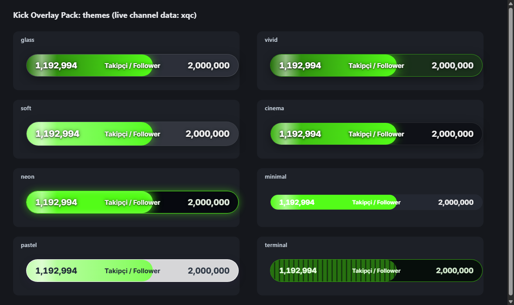

<a id="top"></a>
# Kick Streamer Overlay Pack

Free, no-code OBS overlays for [Kick](https://kick.com): follower and subscriber goal bars, a viewer and uptime panel, and a studio that writes your settings file.

 

**Read this in:** [English](#english) · [Türkçe](#turkce)

---

<a id="english"></a>
## English

### Overview

Pick a look in `studio.html`, enter your channel name, and add the overlay files to OBS as Browser sources. There is no server to run.

Status as of 2026-10-15:

- **Followers** are read from Kick's public channel data and were checked against a live channel. **Viewers and uptime** use the same public data, but have not yet been checked during a live stream.
- **Subscriber total** uses Kick's official API and needs a free Kick developer app (see [Configuration](#configuration-en)). It has been tested against a local mock of that API, not yet with a real app. Without an app, enter the count by hand.
- **Live chat does not work yet.** Kick rejects the public chat feed the overlay used (Pusher error 4001). `chat.html` stays empty instead of showing fake messages.



### Features

- 8 themes: `glass`, `vivid`, `soft`, `cinema`, `neon`, `minimal`, `pastel`, `terminal`
- 3 corner shapes, 4 fonts, labels in Turkish, English or both, and 3 motion levels
- Optional percentage, and a session gain such as "+3 this stream"
- Studio with live previews, three presets, and a downloadable `AYARLAR.js`

### Requirements

- OBS Studio with Browser sources
- A Kick channel name
- Optional: a Kick developer app (client ID and secret) for the subscriber total
- Node.js 18 or newer, only to run the tests

### Installation

1. Download this repository (or its ZIP) and keep the folder in a permanent place.
2. Open `studio.html` in your browser. Pick a look, enter your channel name, and download `AYARLAR.js`. Replace the file in the folder with it. You can also edit `AYARLAR.js` by hand.
3. In OBS, add a source: **Sources → + → Browser**, tick **Local file**, choose an overlay file, and set the width and height from the table below.
4. After changing settings, right-click the source and choose **Refresh**.

### Usage

| File | Shows | OBS size (W × H) |
|---|---|---|
| `follower-bar.html` | Follower goal | 520 × 90 |
| `subscriber-bar.html` | Subscriber goal | 520 × 90 |
| `combined-bar.html` | Followers and subscribers in one panel | 520 × 180 |
| `info-panel.html` | Viewers and uptime, shown only while live | 300 × 80 |
| `chat.html` | Live chat (not available yet, see Status above) | 460 × 760 |
| `studio.html` | Configurator. Open it in a browser, not in OBS | — |

Troubleshooting:

- **`⚙ AYARLAR.js → kanal`** is shown: set `kanal` in `AYARLAR.js` and refresh the source.
- **"Kick uygulama bilgisi hatalı"** (Kick app credentials rejected): check `kickClientId` and `kickClientSecret` in `AYARLAR.local.js`. The studio's test button shows the same error.
- **"Kick'e ulaşılamadı"** (Kick did not answer): the last value stays on screen and the overlay retries.
- **Subscriber count is 0**: no Kick app is configured, so the value comes from `aboneSayisi`.

<a id="configuration-en"></a>
### Configuration

All settings live in `AYARLAR.js`. Invalid values fall back to the default, and numbers are clamped to their range.

| Setting | Values | Default |
|---|---|---|
| `kanal` | Your channel name, as in `kick.com/NAME` | *(empty)* |
| `stil` | `glass` · `vivid` · `soft` · `cinema` · `neon` · `minimal` · `pastel` · `terminal` | `glass` |
| `sekil` | `pill` · `rounded` · `square` | `pill` |
| `yaziTipi` | `inter` · `poppins` · `nunito` · `mono` | `inter` |
| `dil` | `tr` · `en` · `both` | `both` |
| `animasyon` | `normal` · `low` · `off` | `normal` |
| `renk` | Accent colour, hex (e.g. `#53fc18`) | `#53fc18` |
| `yayinciYazisi` | Label next to your name in chat (chat only) | `Streamer` |
| `takipciHedefi` | Follower goal | `1000` |
| `takipciYedek` | Follower count shown if Kick cannot be reached | `0` |
| `aboneHedefi` | Subscriber goal | `100` |
| `aboneSayisi` | Subscriber count when no Kick app is configured | `0` |
| `oturumFarkiGoster` | Show the gain during this stream, e.g. "+3" | `true` |
| `yuzdeGoster` | Show the percentage of the goal | `false` |
| `yenilemeSn` | Refresh interval in seconds (10–600) | `30` |
| `sohbetMaksMesaj` | Most chat messages on screen at once (3–20) | `8` |

**Kick app for the subscriber total (optional)**

1. Create an app in Kick's developer area. The documentation is at [docs.kick.com](https://docs.kick.com).
2. Next to `AYARLAR.js`, create `AYARLAR.local.js`:

   ```js
   window.KICK_OVERLAY_YEREL = {
     kickClientId: "YOUR_CLIENT_ID",
     kickClientSecret: "YOUR_CLIENT_SECRET"
   };
   ```

3. Keep this file private. It is listed in `.gitignore`, so Git will not track it. Never share it or commit it.

The overlay gets and renews its own access token. Kick documents `active_subscribers_count` for the channel but does not describe it, so use the studio's **Test connection** button to confirm that the number matches your subscriber total.

### Contributing

- Run the unit tests with `node tests/run.js` (Node.js 18+, no packages).
- Run the browser tests with `node tests/e2e-chrome.js`. They need Chrome or Edge. Add `--live` for real Kick calls and `--token` for the local mock.
- Pages must stay classic scripts so they work from `file://`, and they should use the shared `.ko-*` components in `shared/themes.css`.

### License

Free for everyone, including commercial streaming. Attribution is appreciated but not required. See [LICENSE](LICENSE). This project is not affiliated with Kick.

© 2026 𝓐.𝓒.𝓑 · [kick.com/iacbi](https://kick.com/iacbi)

[⬆ Back to top](#top)

---

<a id="turkce"></a>
## Türkçe

### Genel Bakış

`studio.html` içinde bir görünüm seç, kanal adını yaz, dosyaları OBS'ye Tarayıcı kaynağı olarak ekle. Çalıştırılacak bir sunucu yok.

2026-10-15 itibarıyla durum:

- **Takipçi** Kick'in herkese açık kanal verisinden okunur ve canlı bir kanalla kontrol edildi. **İzleyici ve yayın süresi** aynı veriyi kullanır, ancak henüz gerçek bir yayında kontrol edilmedi.
- **Abone toplamı** Kick'in resmi API'sinden gelir ve ücretsiz bir Kick geliştirici uygulaması gerektirir (bkz. [Yapılandırma](#yapilandirma-tr)). Yerel bir sahte API ile test edildi, gerçek uygulamayla henüz değil. Uygulamanız yoksa sayıyı elle gir.
- **Canlı sohbet şu an çalışmıyor.** Overlay'in kullandığı genel sohbet akışını Kick reddediyor (Pusher hata 4001). `chat.html` sahte mesaj göstermek yerine boş kalır.


### Özellikler

- 8 tema: `glass`, `vivid`, `soft`, `cinema`, `neon`, `minimal`, `pastel`, `terminal`
- 3 köşe şekli, 4 yazı tipi, Türkçe, İngilizce ya da ikisi birden etiketler, 3 hareket seviyesi
- İsteğe bağlı yüzde gösterimi ve "bu yayında +3" gibi yayın içi artış
- Canlı önizlemeli, üç hazır ayarlı ve indirilebilir `AYARLAR.js` içeren studio

### Gereksinimler

- Tarayıcı kaynağı destekleyen OBS Studio
- Bir Kick kanal adı
- İsteğe bağlı: abone toplamı için bir Kick geliştirici uygulaması (client ID ve client secret)
- Yalnızca testleri çalıştırmak için Node.js 18 veya üstü

### Kurulum

1. Bu depoyu indir (ZIP veya git clone) ve klasörü kalıcı bir yere koy.
2. `studio.html` dosyasını tarayıcıda aç. Bir görünüm seç, kanal adını yaz ve `AYARLAR.js` dosyasını indir. İndirdiğin dosyayla klasördekini değiştir. İstersen `AYARLAR.js` dosyasını elle de düzenleyebilirsin.
3. OBS'de kaynak ekle: **Kaynaklar → + → Tarayıcı**, **Yerel dosya** kutusunu işaretle, bir overlay dosyası seç ve genişlik ile yüksekliği aşağıdaki tablodan ayarla.
4. Ayarları değiştirdikten sonra kaynağa sağ tıkla ve **Yenile**'yi seç.

### Kullanım

| Dosya | Gösterdiği | OBS boyutu (G × Y) |
|---|---|---|
| `follower-bar.html` | Takipçi hedefi | 520 × 90 |
| `subscriber-bar.html` | Abone hedefi | 520 × 90 |
| `combined-bar.html` | Takipçi ve aboneler tek panelde | 520 × 180 |
| `info-panel.html` | İzleyici ve yayın süresi, yalnızca yayındayken | 300 × 80 |
| `chat.html` | Canlı sohbet (henüz çalışmıyor, yukarıdaki Genel Bakış'a bak) | 460 × 760 |
| `studio.html` | Yapılandırıcı. OBS'de değil, tarayıcıda aç | — |

Sorun giderme:

- **`⚙ AYARLAR.js → kanal`** yazısı görünüyorsa `AYARLAR.js` içinde `kanal` alanını doldur ve kaynağı yenile.
- **"Kick uygulama bilgisi hatalı"**: `AYARLAR.local.js` içindeki `kickClientId` ve `kickClientSecret` değerlerini kontrol et. Studio'daki test düğmesi aynı hatayı gösterir.
- **"Kick'e ulaşılamadı"**: Kick yanıt vermedi. Ekranda son değer kalır ve overlay yeniden dener.
- **Abone sayısı 0**: Kick uygulaması tanımlı değil, değer `aboneSayisi` alanından gelir.

<a id="yapilandirma-tr"></a>
### Yapılandırma

Tüm ayarlar `AYARLAR.js` içindedir. Geçersiz değerler varsayılana döner, sayılar kendi aralıklarına sıkıştırılır.

| Ayar | Değerler | Varsayılan |
|---|---|---|
| `kanal` | Kick kanal adın, `kick.com/ADIN` içindeki gibi | *(boş)* |
| `stil` | `glass` · `vivid` · `soft` · `cinema` · `neon` · `minimal` · `pastel` · `terminal` | `glass` |
| `sekil` | `pill` · `rounded` · `square` | `pill` |
| `yaziTipi` | `inter` · `poppins` · `nunito` · `mono` | `inter` |
| `dil` | `tr` · `en` · `both` | `both` |
| `animasyon` | `normal` · `low` · `off` | `normal` |
| `renk` | Vurgu rengi, hex (ör. `#53fc18`) | `#53fc18` |
| `yayinciYazisi` | Sohbette senin adının yanındaki etiket (yalnızca chat) | `Streamer` |
| `takipciHedefi` | Takipçi hedefi | `1000` |
| `takipciYedek` | Kick'e ulaşılamadığında gösterilecek takipçi sayısı | `0` |
| `aboneHedefi` | Abone hedefi | `100` |
| `aboneSayisi` | Kick uygulaması yokken gösterilecek abone sayısı | `0` |
| `oturumFarkiGoster` | Bu yayındaki artışı göster, ör. "+3" | `true` |
| `yuzdeGoster` | Hedefin yüzdesini göster | `false` |
| `yenilemeSn` | Yenileme aralığı, saniye (10–600) | `30` |
| `sohbetMaksMesaj` | Ekranda aynı anda en fazla sohbet mesajı (3–20) | `8` |

**Abone toplamı için Kick uygulaması (isteğe bağlı)**

1. Kick'in geliştirici alanında bir uygulama oluştur. Dokümantasyon [docs.kick.com](https://docs.kick.com) adresinde.
2. `AYARLAR.js` ile aynı klasörde `AYARLAR.local.js` dosyası oluştur:

   ```js
   window.KICK_OVERLAY_YEREL = {
     kickClientId: "CLIENT_ID_BURAYA",
     kickClientSecret: "CLIENT_SECRET_BURAYA"
   };
   ```

3. Bu dosyayı gizli tut. `.gitignore` dosyasında listelidir, Git onu takip etmez. Kimseyle paylaşma ve commit etme.

Overlay erişim anahtarını kendisi alır ve yeniler. Kick, kanal için `active_subscribers_count` alanını belgeler ama açıklamaz. Sayının gerçekten abone toplamın olduğunu studio'daki **Bağlantıyı test et** düğmesiyle doğrula.

### Katkı

- Birim testleri çalıştır: `node tests/run.js` (Node.js 18+, paket gerekmez).
- Tarayıcı testleri: `node tests/e2e-chrome.js`. Chrome veya Edge gerekir. Gerçek Kick çağrıları için `--live`, yerel sahte sunucu için `--token` ekle.
- Sayfalar `file://` üzerinden çalışabilmek için klasik script olarak kalmalı ve `shared/themes.css` içindeki ortak `.ko-*` bileşenlerini kullanmalı.

### Lisans

Ticari yayın dahil herkes için ücretsiz. Kaynak göstermek hoş karşılanır ama zorunlu değildir. Ayrıntılar için [LICENSE](LICENSE). Bu proje Kick ile bağlantılı değildir.

© 2026 𝓐.𝓒.𝓑 · [kick.com/iacbi](https://kick.com/iacbi)

[⬆ Başa Dön](#top)
