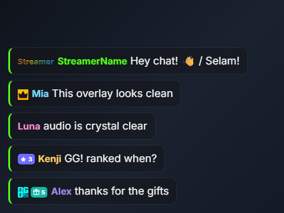
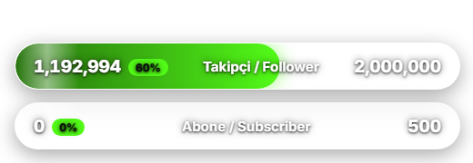
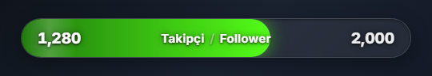
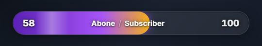
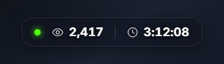
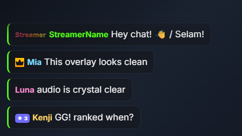
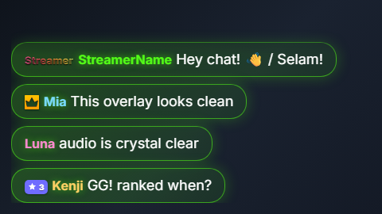
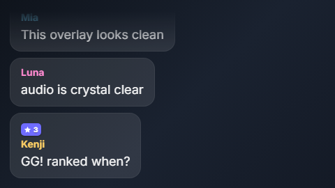
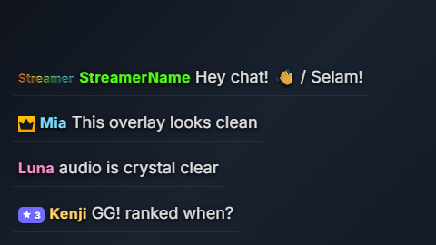

<div align="center">

# 🎥 Kick Streamer Overlay Pack
### Kick Yayıncı Overlay Paketi

**Free, no-code, server-less live overlays for [Kick](https://kick.com).**
Live chat · follower & subscriber goal bars · viewer + uptime panel.

    [](https://kick.com/iacbi)

### ✨ Preview / Önizleme











<sub>Style shown: <code>glass</code> · accent <code>#53fc18</code>. Numbers are examples. / Gösterilen stil: <code>glass</code>. Sayılar örnektir.</sub>

### 🎨 4 built-in styles / 4 hazır stil

<table>
<tr>
<td align="center"><code>glass</code><br></td>
<td align="center"><code>vivid</code><br></td>
</tr>
<tr>
<td align="center"><code>soft</code><br></td>
<td align="center"><code>cinema</code><br></td>
</tr>
</table>

<sub>Pick one via <code>stil</code> in <code>AYARLAR.js</code>. Works across all overlays. / Stili <code>AYARLAR.js</code> içindeki <code>stil</code> ile seç; tüm overlay'lerde geçerli.</sub>

**🌐 Read in your language / Kendi dilinde oku:**

[🇬🇧 English](#english) · [🇹🇷 Türkçe](#turkce) · [🇯🇵 日本語](#japanese) · [🇪🇸 Español](#espanol) · [🇧🇷 Português](#portugues) · [🇫🇷 Français](#francais) · [🇩🇪 Deutsch](#deutsch) · [🇷🇺 Русский](#russian) · [🇸🇦 العربية](#arabic) · [🇰🇷 한국어](#korean) · [🇨🇳 中文](#chinese) · [🇮🇩 Indonesia](#indonesia)

</div>

---

<a id="english"></a>
## 🇬🇧 English

**No coding. No server. No monthly fee.** You only edit ONE small text file (`AYARLAR.js`), type your Kick channel name, and add the overlays to OBS. That's it.

### 📦 What's inside

| File | What it shows on stream | OBS size (W × H) |
|---|---|---|
| `chat.html` | Live chat with badges & emotes | **460 × 760** |
| `follower-bar.html` | Follower goal bar | **520 × 90** |
| `subscriber-bar.html` | Subscriber goal bar (live counter) | **520 × 90** |
| `combined-bar.html` | Follower **+** subscriber in one panel | **520 × 180** |
| `info-panel.html` | Live viewer count **+** stream uptime | **300 × 80** |

> 💡 Use **either** the two separate bars (`follower-bar` + `subscriber-bar`) **or** the single `combined-bar` — whichever you prefer.

### ✅ What you need
- **OBS Studio** (or Streamlabs) — free.
- A **Kick channel** (your channel name, e.g. `kick.com/yourname` → `yourname`).

### 🚀 Setup in 4 steps
1. **Download** this folder and unzip it somewhere you won't delete (e.g. Documents).
2. **Open `AYARLAR.js`** with Notepad (right-click → Open with → Notepad). Type your channel name between the quotes and save:
   ```js
   kanal: "yourname",
   ```
   *(Optional: also set `stil`, `renk`, goals — see the table below.)*
3. In **OBS**: `Sources` → `+` → **Browser** → tick **Local file** → **Browse** → pick an overlay (e.g. `chat.html`). Enter its **Width** and **Height** from the table above. Click OK.
   Repeat for each overlay you want.
4. **Done!** If you change `AYARLAR.js` later, right-click the source in OBS → **Refresh**.

### 🎨 Customization — `AYARLAR.js`

| Setting | What it does |
|---|---|
| `kanal` | Your Kick channel name (required) |
| `stil` | Visual style: `glass` · `vivid` · `soft` · `cinema` |
| `renk` | Accent color (hex), e.g. `"#53fc18"` |
| `takipciHedefi` | Follower goal (number on the right of the bar) |
| `takipciYedek` | Fallback follower number if Kick can't be reached |
| `aboneHedefi` | Subscriber goal |
| `yayinciYazisi` | Label next to YOUR name in chat (e.g. `"Streamer"`) |
| `yenilemeSn` | How often (seconds) to refresh |

> The `combined-bar` has its own fixed design and ignores `stil`/`renk`.

### 📊 How the data works (honest)
- **Chat** — fully live via Kick's chat socket. Badges are shown as clean drawn symbols; subscriber month-badges are pulled automatically from your channel.
- **Followers** — live follower count from Kick, refreshed automatically.
- **Subscribers** — Kick gives **no total subscriber number** anywhere, so the bar is a **live counter that starts at 0** and goes up automatically with each new sub / gifted sub during your stream.
- **Viewer + uptime panel** — live; it is **hidden while you're offline** (so there's no empty box) and appears when you go live.

### 🏅 Optional badges
The `badges/` folder is optional. Drop your own role-badge images there to replace the drawn ones — see `badges/OKU-README.txt`. Everything works with it empty.

### 🛠️ Troubleshooting
- **Overlay looks empty?** The info-panel is hidden while offline — that's normal. The bars/chat show a "Set your channel" hint if `kanal` is empty.
- **Nothing updates?** Check your channel name spelling in `AYARLAR.js`, then Refresh the source in OBS.
- **Uses Kick's unofficial endpoints** — if Kick changes them one day, an update may be needed.

### 📜 License
Free for everyone, including commercial streaming. Attribution appreciated but not required. See `LICENSE`. Not affiliated with Kick.

---

<a id="turkce"></a>
## 🇹🇷 Türkçe

**Kod yok. Sunucu yok. Aylık ücret yok.** Sadece TEK küçük dosyayı (`AYARLAR.js`) açıp kanal adını yazıyorsun ve overlay'leri OBS'ye ekliyorsun. Hepsi bu.

### 📦 Pakette ne var

| Dosya | Yayında ne gösterir | OBS boyutu (G × Y) |
|---|---|---|
| `chat.html` | Rozet ve emote'larla canlı sohbet | **460 × 760** |
| `follower-bar.html` | Takipçi hedef barı | **520 × 90** |
| `subscriber-bar.html` | Abone hedef barı (canlı sayaç) | **520 × 90** |
| `combined-bar.html` | Takipçi **+** abone tek panelde | **520 × 180** |
| `info-panel.html` | Canlı izleyici **+** yayın süresi | **300 × 80** |

> 💡 İstersen iki ayrı barı (`follower-bar` + `subscriber-bar`), istersen tek `combined-bar`'ı kullan.

### ✅ Gerekenler
- **OBS Studio** (veya Streamlabs) — ücretsiz.
- Bir **Kick kanalı** (kanal adın, örn. `kick.com/adin` → `adin`).

### 🚀 4 adımda kurulum
1. Bu klasörü **indir** ve silmeyeceğin bir yere çıkar (örn. Belgeler).
2. **`AYARLAR.js`'i Not Defteri** ile aç (sağ tık → Birlikte aç → Not Defteri). Tırnakların arasına kanal adını yaz ve kaydet:
   ```js
   kanal: "adin",
   ```
   *(İsteğe bağlı: `stil`, `renk`, hedefleri de ayarlayabilirsin — aşağıdaki tabloya bak.)*
3. **OBS**'de: `Kaynaklar` → `+` → **Tarayıcı (Browser)** → **Yerel dosya (Local file)** kutusunu işaretle → **Gözat** → bir overlay seç (örn. `chat.html`). Yukarıdaki tablodaki **Genişlik** ve **Yükseklik** değerlerini gir. Tamam'a bas.
   İstediğin her overlay için tekrarla.
4. **Bitti!** `AYARLAR.js`'i sonradan değiştirirsen OBS'de kaynağa sağ tık → **Yenile (Refresh)**.

### 🎨 Özelleştirme — `AYARLAR.js`

| Ayar | Ne işe yarar |
|---|---|
| `kanal` | Kick kanal adın (zorunlu) |
| `stil` | Görünüm: `glass` · `vivid` · `soft` · `cinema` |
| `renk` | Vurgu rengi (hex), örn. `"#53fc18"` |
| `takipciHedefi` | Takipçi hedefi (barın sağındaki sayı) |
| `takipciYedek` | Kick'e ulaşılamazsa gösterilecek yedek takipçi sayısı |
| `aboneHedefi` | Abone hedefi |
| `yayinciYazisi` | Chat'te SENİN isminin yanındaki yazı (örn. `"Yayıncı"`) |
| `yenilemeSn` | Kaç saniyede bir yenilensin |

> `combined-bar` kendi sabit tasarımına sahiptir; `stil`/`renk` onu etkilemez.

### 📊 Veri nasıl çalışır (dürüst)
- **Sohbet** — Kick'in chat soketinden tam canlı. Rozetler temiz çizili sembollerle gösterilir; abonelerin aylık rozetleri kanalından otomatik çekilir.
- **Takipçi** — Kick'ten canlı takipçi sayısı, otomatik yenilenir.
- **Abone** — Kick hiçbir yerde **toplam abone sayısı vermez**; bu yüzden bar **0'dan başlayan canlı bir sayaçtır** ve yayın boyunca her yeni abone / hediye abone ile otomatik artar.
- **İzleyici + süre paneli** — canlı; **yayın kapalıyken gizlidir** (boş kutu durmaz), yayına geçince görünür.

### 🏅 İsteğe bağlı rozetler
`badges/` klasörü isteğe bağlıdır. Çizili rozetlerin yerine kendi rozet görsellerini koyabilirsin — bkz. `badges/OKU-README.txt`. Klasör boşken de her şey çalışır.

### 🛠️ Sık sorunlar
- **Overlay boş mu görünüyor?** Bilgi paneli yayın kapalıyken gizlidir — bu normaldir. `kanal` boşsa bar/chat "Kanal adını gir" ipucu gösterir.
- **Güncellenmiyor mu?** `AYARLAR.js` içindeki kanal adının yazımını kontrol et, sonra OBS'de kaynağı Yenile.
- **Kick'in resmi olmayan uçlarını kullanır** — Kick bir gün değiştirirse güncelleme gerekebilir.

### 📜 Lisans
Ticari yayın dahil herkese ücretsiz. Atıf hoş karşılanır ama zorunlu değildir. Bkz. `LICENSE`. Kick ile bağlantılı değildir.

---

<a id="japanese"></a>
## 🇯🇵 日本語

**コード不要・サーバー不要・月額不要。** 小さなファイル（`AYARLAR.js`）を1つ編集して Kick のチャンネル名を入力し、OBS にオーバーレイを追加するだけです。

### 📦 同梱内容

| ファイル | 配信での表示 | OBS サイズ (幅 × 高さ) |
|---|---|---|
| `chat.html` | バッジ・エモート付きのライブチャット | **460 × 760** |
| `follower-bar.html` | フォロワー目標バー | **520 × 90** |
| `subscriber-bar.html` | サブスク目標バー（ライブカウンター） | **520 × 90** |
| `combined-bar.html` | フォロワー **+** サブスクを1つのパネルに | **520 × 180** |
| `info-panel.html` | 視聴者数 **+** 配信時間 | **300 × 80** |

> 💡 別々の2本のバー（`follower-bar` + `subscriber-bar`）か、1つの `combined-bar` のどちらかをお好みで使ってください。

### ✅ 必要なもの
- **OBS Studio**（または Streamlabs）— 無料。
- **Kick チャンネル**（例: `kick.com/yourname` → `yourname`）。

### 🚀 4ステップで設定
1. このフォルダを**ダウンロード**し、削除しない場所に解凍します。
2. **`AYARLAR.js`** をメモ帳で開き、引用符の間にチャンネル名を入力して保存します:
   ```js
   kanal: "yourname",
   ```
   *(任意: `stil`・`renk`・目標値も設定できます。下表参照。)*
3. **OBS** で: `ソース` → `+` → **ブラウザ** → **ローカルファイル** にチェック → **参照** → オーバーレイ（例: `chat.html`）を選択。上表の**幅**と**高さ**を入力して OK。
   使いたいオーバーレイごとに繰り返します。
4. **完了！** 後で `AYARLAR.js` を変更したら、OBS でソースを右クリック → **更新（Refresh）**。

### 🎨 カスタマイズ — `AYARLAR.js`

| 設定 | 内容 |
|---|---|
| `kanal` | Kick チャンネル名（必須） |
| `stil` | スタイル: `glass` · `vivid` · `soft` · `cinema` |
| `renk` | アクセントカラー（16進）例 `"#53fc18"` |
| `takipciHedefi` | フォロワー目標 |
| `takipciYedek` | Kick に接続できない時の代替フォロワー数 |
| `aboneHedefi` | サブスク目標 |
| `yayinciYazisi` | チャットで自分の名前の横に出すラベル（例 `"Streamer"`） |
| `yenilemeSn` | 更新間隔（秒） |

> `combined-bar` は独自の固定デザインで、`stil`/`renk` は適用されません。

### 📊 データの仕組み（正直な説明）
- **チャット** — Kick のチャットソケットから完全ライブ。バッジはきれいな描画シンボルで表示し、サブスクの月数バッジはチャンネルから自動取得します。
- **フォロワー** — Kick からライブのフォロワー数を自動更新。
- **サブスク** — Kick は**合計サブスク数を一切提供しない**ため、このバーは**0から始まるライブカウンター**で、配信中の新規サブ/ギフトごとに自動で増えます。
- **視聴者+配信時間パネル** — ライブ。**オフライン時は非表示**（空箱が出ません）で、配信開始で表示されます。

### 🏅 任意のバッジ
`badges/` フォルダは任意です。独自のロールバッジ画像を入れると描画シンボルの代わりに使われます（`badges/OKU-README.txt` 参照）。空でも問題なく動作します。

### 🛠️ トラブルシューティング
- **オーバーレイが空？** 情報パネルはオフライン時に非表示で正常です。`kanal` が空のとき、バー/チャットは「チャンネル名を設定」のヒントを表示します。
- **更新されない？** `AYARLAR.js` のチャンネル名のスペルを確認し、OBS でソースを更新してください。
- **Kick の非公式エンドポイントを使用** — Kick が変更した場合は更新が必要になることがあります。

### 📜 ライセンス
商用配信を含め誰でも無料。クレジットは歓迎ですが必須ではありません。`LICENSE` 参照。Kick とは無関係です。

---

<a id="espanol"></a>
## 🇪🇸 Español

**Sin programación. Sin servidor. Sin cuota mensual.** Solo editas UN pequeño archivo (`AYARLAR.js`), escribes el nombre de tu canal de Kick y añades los overlays a OBS. Eso es todo.

### 📦 Qué incluye

| Archivo | Qué muestra en directo | Tamaño OBS (An × Al) |
|---|---|---|
| `chat.html` | Chat en vivo con insignias y emotes | **460 × 760** |
| `follower-bar.html` | Barra de meta de seguidores | **520 × 90** |
| `subscriber-bar.html` | Barra de meta de suscriptores (contador en vivo) | **520 × 90** |
| `combined-bar.html` | Seguidores **+** suscriptores en un panel | **520 × 180** |
| `info-panel.html` | Espectadores en vivo **+** tiempo de emisión | **300 × 80** |

> 💡 Usa **o bien** las dos barras separadas, **o bien** la barra `combined-bar`, como prefieras.

### ✅ Qué necesitas
- **OBS Studio** (o Streamlabs) — gratis.
- Un **canal de Kick** (ej. `kick.com/tunombre` → `tunombre`).

### 🚀 Configuración en 4 pasos
1. **Descarga** esta carpeta y descomprímela donde no la borres.
2. **Abre `AYARLAR.js`** con el Bloc de notas y escribe tu canal entre las comillas y guarda:
   ```js
   kanal: "tunombre",
   ```
   *(Opcional: ajusta `stil`, `renk` y las metas — ver tabla.)*
3. En **OBS**: `Fuentes` → `+` → **Navegador** → marca **Archivo local** → **Examinar** → elige un overlay (ej. `chat.html`). Pon el **Ancho** y **Alto** de la tabla. Acepta.
   Repite con cada overlay.
4. **¡Listo!** Si cambias `AYARLAR.js` después, clic derecho en la fuente en OBS → **Actualizar (Refresh)**.

### 🎨 Personalización — `AYARLAR.js`

| Ajuste | Qué hace |
|---|---|
| `kanal` | Tu nombre de canal de Kick (obligatorio) |
| `stil` | Estilo: `glass` · `vivid` · `soft` · `cinema` |
| `renk` | Color de acento (hex), ej. `"#53fc18"` |
| `takipciHedefi` | Meta de seguidores |
| `takipciYedek` | Seguidores de respaldo si no se conecta a Kick |
| `aboneHedefi` | Meta de suscriptores |
| `yayinciYazisi` | Etiqueta junto a TU nombre en el chat (ej. `"Streamer"`) |
| `yenilemeSn` | Frecuencia de actualización (segundos) |

> La `combined-bar` tiene su propio diseño fijo e ignora `stil`/`renk`.

### 📊 Cómo funcionan los datos (con honestidad)
- **Chat** — totalmente en vivo. Las insignias se muestran como símbolos dibujados; las insignias mensuales de suscriptor se obtienen automáticamente de tu canal.
- **Seguidores** — recuento en vivo desde Kick, se actualiza solo.
- **Suscriptores** — Kick **no da ningún total de suscriptores**, así que la barra es un **contador en vivo que empieza en 0** y sube automáticamente con cada nueva suscripción/regalo durante tu directo.
- **Panel de espectadores + tiempo** — en vivo; **se oculta cuando estás offline** y aparece al emitir.

### 🏅 Insignias opcionales
La carpeta `badges/` es opcional. Pon tus propias imágenes de insignias para reemplazar las dibujadas — ver `badges/OKU-README.txt`. Funciona vacía.

### 🛠️ Solución de problemas
- **¿Overlay vacío?** El panel de info se oculta offline (es normal). Si `kanal` está vacío, las barras/chat muestran una pista para configurarlo.
- **¿No se actualiza?** Revisa el nombre del canal en `AYARLAR.js` y actualiza la fuente en OBS.
- **Usa endpoints no oficiales de Kick** — si Kick los cambia, podría requerir una actualización.

### 📜 Licencia
Gratis para todos, incluido el uso comercial. Atribución agradecida pero no obligatoria. Ver `LICENSE`. No afiliado a Kick.

---

<a id="portugues"></a>
## 🇧🇷 Português

**Sem programação. Sem servidor. Sem mensalidade.** Você edita só UM arquivinho (`AYARLAR.js`), escreve o nome do seu canal da Kick e adiciona os overlays ao OBS. Só isso.

### 📦 O que vem incluso

| Arquivo | O que mostra na live | Tamanho OBS (L × A) |
|---|---|---|
| `chat.html` | Chat ao vivo com badges e emotes | **460 × 760** |
| `follower-bar.html` | Barra de meta de seguidores | **520 × 90** |
| `subscriber-bar.html` | Barra de meta de inscritos (contador ao vivo) | **520 × 90** |
| `combined-bar.html` | Seguidores **+** inscritos num painel | **520 × 180** |
| `info-panel.html` | Espectadores ao vivo **+** tempo de live | **300 × 80** |

> 💡 Use **ou** as duas barras separadas, **ou** a `combined-bar`, como preferir.

### ✅ O que você precisa
- **OBS Studio** (ou Streamlabs) — grátis.
- Um **canal na Kick** (ex.: `kick.com/seunome` → `seunome`).

### 🚀 Configuração em 4 passos
1. **Baixe** esta pasta e descompacte num lugar que você não vá apagar.
2. **Abra o `AYARLAR.js`** no Bloco de Notas, escreva seu canal entre as aspas e salve:
   ```js
   kanal: "seunome",
   ```
   *(Opcional: ajuste `stil`, `renk` e as metas — veja a tabela.)*
3. No **OBS**: `Fontes` → `+` → **Navegador** → marque **Arquivo local** → **Procurar** → escolha um overlay (ex.: `chat.html`). Coloque **Largura** e **Altura** da tabela. OK.
   Repita para cada overlay.
4. **Pronto!** Se mudar o `AYARLAR.js` depois, clique com o botão direito na fonte no OBS → **Atualizar (Refresh)**.

### 🎨 Personalização — `AYARLAR.js`

| Ajuste | O que faz |
|---|---|
| `kanal` | Nome do seu canal na Kick (obrigatório) |
| `stil` | Estilo: `glass` · `vivid` · `soft` · `cinema` |
| `renk` | Cor de destaque (hex), ex.: `"#53fc18"` |
| `takipciHedefi` | Meta de seguidores |
| `takipciYedek` | Seguidores reserva se não conectar à Kick |
| `aboneHedefi` | Meta de inscritos |
| `yayinciYazisi` | Etiqueta ao lado do SEU nome no chat (ex.: `"Streamer"`) |
| `yenilemeSn` | Frequência de atualização (segundos) |

> A `combined-bar` tem design fixo próprio e ignora `stil`/`renk`.

### 📊 Como os dados funcionam (com honestidade)
- **Chat** — totalmente ao vivo. Badges aparecem como símbolos desenhados; os badges mensais de inscrito vêm automaticamente do seu canal.
- **Seguidores** — contagem ao vivo da Kick, atualiza sozinho.
- **Inscritos** — a Kick **não fornece total de inscritos** em lugar nenhum, então a barra é um **contador ao vivo que começa em 0** e sobe sozinho a cada nova inscrição/presente durante a live.
- **Painel de espectadores + tempo** — ao vivo; **fica oculto quando você está offline** e aparece ao iniciar a live.

### 🏅 Badges opcionais
A pasta `badges/` é opcional. Coloque suas próprias imagens de badge para substituir as desenhadas — veja `badges/OKU-README.txt`. Funciona vazia.

### 🛠️ Solução de problemas
- **Overlay vazio?** O painel de info fica oculto offline (é normal). Se `kanal` estiver vazio, barras/chat mostram uma dica para configurar.
- **Não atualiza?** Confira a grafia do canal em `AYARLAR.js` e atualize a fonte no OBS.
- **Usa endpoints não oficiais da Kick** — se a Kick mudar, pode exigir atualização.

### 📜 Licença
Grátis para todos, incluindo uso comercial. Crédito é bem-vindo mas não obrigatório. Veja `LICENSE`. Não afiliado à Kick.

---

<a id="francais"></a>
## 🇫🇷 Français

**Sans code. Sans serveur. Sans abonnement.** Vous modifiez UN seul petit fichier (`AYARLAR.js`), saisissez le nom de votre chaîne Kick, et ajoutez les overlays à OBS. C'est tout.

### 📦 Contenu

| Fichier | Ce qu'il affiche en direct | Taille OBS (L × H) |
|---|---|---|
| `chat.html` | Chat en direct avec badges et emotes | **460 × 760** |
| `follower-bar.html` | Barre d'objectif d'abonnés (followers) | **520 × 90** |
| `subscriber-bar.html` | Barre d'objectif de subs (compteur en direct) | **520 × 90** |
| `combined-bar.html` | Followers **+** subs dans un panneau | **520 × 180** |
| `info-panel.html` | Spectateurs en direct **+** durée du live | **300 × 80** |

> 💡 Utilisez **soit** les deux barres séparées, **soit** la `combined-bar`, au choix.

### ✅ Ce qu'il vous faut
- **OBS Studio** (ou Streamlabs) — gratuit.
- Une **chaîne Kick** (ex. `kick.com/votrenom` → `votrenom`).

### 🚀 Installation en 4 étapes
1. **Téléchargez** ce dossier et décompressez-le dans un endroit sûr.
2. **Ouvrez `AYARLAR.js`** avec le Bloc-notes, saisissez votre chaîne entre les guillemets et enregistrez :
   ```js
   kanal: "votrenom",
   ```
   *(Optionnel : réglez aussi `stil`, `renk` et les objectifs — voir le tableau.)*
3. Dans **OBS** : `Sources` → `+` → **Navigateur** → cochez **Fichier local** → **Parcourir** → choisissez un overlay (ex. `chat.html`). Entrez la **Largeur** et la **Hauteur** du tableau. OK.
   Répétez pour chaque overlay.
4. **Terminé !** Si vous modifiez `AYARLAR.js` ensuite, clic droit sur la source dans OBS → **Actualiser (Refresh)**.

### 🎨 Personnalisation — `AYARLAR.js`

| Réglage | Rôle |
|---|---|
| `kanal` | Nom de votre chaîne Kick (obligatoire) |
| `stil` | Style : `glass` · `vivid` · `soft` · `cinema` |
| `renk` | Couleur d'accent (hex), ex. `"#53fc18"` |
| `takipciHedefi` | Objectif de followers |
| `takipciYedek` | Followers de secours si Kick est injoignable |
| `aboneHedefi` | Objectif de subs |
| `yayinciYazisi` | Libellé à côté de VOTRE nom dans le chat (ex. `"Streamer"`) |
| `yenilemeSn` | Fréquence de rafraîchissement (secondes) |

> La `combined-bar` a son propre design fixe et ignore `stil`/`renk`.

### 📊 Comment fonctionnent les données (en toute honnêteté)
- **Chat** — entièrement en direct. Les badges sont des symboles dessinés ; les badges mensuels d'abonné sont récupérés automatiquement depuis votre chaîne.
- **Followers** — nombre en direct depuis Kick, actualisé automatiquement.
- **Subs** — Kick **ne fournit aucun total d'abonnés**, donc la barre est un **compteur en direct qui démarre à 0** et augmente automatiquement à chaque nouveau sub/sub offert pendant le live.
- **Panneau spectateurs + durée** — en direct ; **masqué hors ligne** et affiché quand vous lancez le live.

### 🏅 Badges optionnels
Le dossier `badges/` est optionnel. Déposez vos propres images de badges pour remplacer celles dessinées — voir `badges/OKU-README.txt`. Fonctionne même vide.

### 🛠️ Dépannage
- **Overlay vide ?** Le panneau d'info est masqué hors ligne (normal). Si `kanal` est vide, les barres/chat affichent une astuce de configuration.
- **Rien ne se met à jour ?** Vérifiez l'orthographe de la chaîne dans `AYARLAR.js`, puis actualisez la source dans OBS.
- **Utilise les endpoints non officiels de Kick** — une mise à jour peut être nécessaire si Kick change.

### 📜 Licence
Gratuit pour tous, usage commercial inclus. Mention appréciée mais non obligatoire. Voir `LICENSE`. Non affilié à Kick.

---

<a id="deutsch"></a>
## 🇩🇪 Deutsch

**Kein Code. Kein Server. Keine monatliche Gebühr.** Du bearbeitest nur EINE kleine Datei (`AYARLAR.js`), trägst deinen Kick-Kanalnamen ein und fügst die Overlays in OBS ein. Das war's.

### 📦 Inhalt

| Datei | Was sie im Stream zeigt | OBS-Größe (B × H) |
|---|---|---|
| `chat.html` | Live-Chat mit Badges und Emotes | **460 × 760** |
| `follower-bar.html` | Follower-Ziel-Leiste | **520 × 90** |
| `subscriber-bar.html` | Abo-Ziel-Leiste (Live-Zähler) | **520 × 90** |
| `combined-bar.html` | Follower **+** Abos in einem Panel | **520 × 180** |
| `info-panel.html` | Live-Zuschauer **+** Stream-Laufzeit | **300 × 80** |

> 💡 Nutze **entweder** die zwei einzelnen Leisten **oder** die `combined-bar`, ganz wie du willst.

### ✅ Was du brauchst
- **OBS Studio** (oder Streamlabs) — kostenlos.
- Einen **Kick-Kanal** (z. B. `kick.com/deinname` → `deinname`).

### 🚀 Einrichtung in 4 Schritten
1. Diesen Ordner **herunterladen** und an einen sicheren Ort entpacken.
2. **`AYARLAR.js`** mit dem Editor öffnen, deinen Kanal zwischen die Anführungszeichen schreiben und speichern:
   ```js
   kanal: "deinname",
   ```
   *(Optional: auch `stil`, `renk` und Ziele setzen — siehe Tabelle.)*
3. In **OBS**: `Quellen` → `+` → **Browser** → **Lokale Datei** anhaken → **Durchsuchen** → ein Overlay wählen (z. B. `chat.html`). **Breite** und **Höhe** aus der Tabelle eintragen. OK.
   Für jedes gewünschte Overlay wiederholen.
4. **Fertig!** Wenn du `AYARLAR.js` später änderst, Rechtsklick auf die Quelle in OBS → **Aktualisieren (Refresh)**.

### 🎨 Anpassung — `AYARLAR.js`

| Einstellung | Funktion |
|---|---|
| `kanal` | Dein Kick-Kanalname (erforderlich) |
| `stil` | Stil: `glass` · `vivid` · `soft` · `cinema` |
| `renk` | Akzentfarbe (Hex), z. B. `"#53fc18"` |
| `takipciHedefi` | Follower-Ziel |
| `takipciYedek` | Ersatz-Followerzahl, falls Kick nicht erreichbar ist |
| `aboneHedefi` | Abo-Ziel |
| `yayinciYazisi` | Label neben DEINEM Namen im Chat (z. B. `"Streamer"`) |
| `yenilemeSn` | Aktualisierungsintervall (Sekunden) |

> Die `combined-bar` hat ein eigenes festes Design und ignoriert `stil`/`renk`.

### 📊 Wie die Daten funktionieren (ehrlich)
- **Chat** — voll live. Badges werden als saubere gezeichnete Symbole gezeigt; monatliche Abo-Badges werden automatisch von deinem Kanal geladen.
- **Follower** — Live-Followerzahl von Kick, automatisch aktualisiert.
- **Abos** — Kick liefert **nirgends eine Gesamt-Abozahl**, daher ist die Leiste ein **Live-Zähler, der bei 0 startet** und bei jedem neuen Abo/Gift-Abo während des Streams automatisch hochzählt.
- **Zuschauer- + Laufzeit-Panel** — live; **offline ausgeblendet** und sichtbar, sobald du live gehst.

### 🏅 Optionale Badges
Der Ordner `badges/` ist optional. Lege eigene Badge-Bilder hinein, um die gezeichneten zu ersetzen — siehe `badges/OKU-README.txt`. Funktioniert auch leer.

### 🛠️ Fehlerbehebung
- **Overlay leer?** Das Info-Panel ist offline ausgeblendet (normal). Bei leerem `kanal` zeigen Leisten/Chat einen Einrichtungshinweis.
- **Nichts aktualisiert sich?** Schreibweise des Kanals in `AYARLAR.js` prüfen, dann Quelle in OBS aktualisieren.
- **Nutzt inoffizielle Kick-Endpunkte** — ändert Kick diese, kann ein Update nötig sein.

### 📜 Lizenz
Kostenlos für alle, auch kommerziell. Namensnennung willkommen, aber nicht erforderlich. Siehe `LICENSE`. Nicht mit Kick verbunden.

---

<a id="russian"></a>
## 🇷🇺 Русский

**Без кода. Без сервера. Без абонплаты.** Вы редактируете ОДИН маленький файл (`AYARLAR.js`), вписываете имя своего канала Kick и добавляете оверлеи в OBS. Вот и всё.

### 📦 Что внутри

| Файл | Что показывает в эфире | Размер OBS (Ш × В) |
|---|---|---|
| `chat.html` | Живой чат со значками и эмоутами | **460 × 760** |
| `follower-bar.html` | Полоса цели по фолловерам | **520 × 90** |
| `subscriber-bar.html` | Полоса цели по подписчикам (живой счётчик) | **520 × 90** |
| `combined-bar.html` | Фолловеры **+** подписчики в одной панели | **520 × 180** |
| `info-panel.html` | Зрители в реальном времени **+** время эфира | **300 × 80** |

> 💡 Используйте **либо** две отдельные полосы, **либо** `combined-bar` — как удобнее.

### ✅ Что нужно
- **OBS Studio** (или Streamlabs) — бесплатно.
- **Канал на Kick** (напр. `kick.com/имя` → `имя`).

### 🚀 Настройка за 4 шага
1. **Скачайте** эту папку и распакуйте туда, где не удалите.
2. **Откройте `AYARLAR.js`** в Блокноте, впишите имя канала в кавычки и сохраните:
   ```js
   kanal: "имя",
   ```
   *(Необязательно: задайте `stil`, `renk` и цели — см. таблицу.)*
3. В **OBS**: `Источники` → `+` → **Браузер** → отметьте **Локальный файл** → **Обзор** → выберите оверлей (напр. `chat.html`). Впишите **Ширину** и **Высоту** из таблицы. ОК.
   Повторите для каждого нужного оверлея.
4. **Готово!** Если потом измените `AYARLAR.js`, ПКМ по источнику в OBS → **Обновить (Refresh)**.

### 🎨 Настройки — `AYARLAR.js`

| Параметр | Что делает |
|---|---|
| `kanal` | Имя вашего канала Kick (обязательно) |
| `stil` | Стиль: `glass` · `vivid` · `soft` · `cinema` |
| `renk` | Акцентный цвет (hex), напр. `"#53fc18"` |
| `takipciHedefi` | Цель по фолловерам |
| `takipciYedek` | Резервное число фолловеров, если Kick недоступен |
| `aboneHedefi` | Цель по подписчикам |
| `yayinciYazisi` | Подпись рядом с ВАШИМ именем в чате (напр. `"Streamer"`) |
| `yenilemeSn` | Частота обновления (секунды) |

> У `combined-bar` собственный фиксированный дизайн, `stil`/`renk` на неё не влияют.

### 📊 Как работают данные (честно)
- **Чат** — полностью вживую. Значки показываются аккуратными нарисованными символами; месячные значки подписчиков подтягиваются автоматически из вашего канала.
- **Фолловеры** — живое число от Kick, обновляется автоматически.
- **Подписчики** — Kick **нигде не даёт общее число подписчиков**, поэтому полоса — это **живой счётчик, стартующий с 0**, который растёт автоматически с каждой новой подпиской/подарком во время эфира.
- **Панель зрителей + время** — вживую; **скрыта, когда вы офлайн**, и появляется в эфире.

### 🏅 Необязательные значки
Папка `badges/` необязательна. Положите свои изображения значков, чтобы заменить нарисованные — см. `badges/OKU-README.txt`. Работает и пустой.

### 🛠️ Решение проблем
- **Оверлей пустой?** Инфо-панель скрыта офлайн — это нормально. Если `kanal` пуст, полосы/чат показывают подсказку о настройке.
- **Ничего не обновляется?** Проверьте написание канала в `AYARLAR.js`, затем обновите источник в OBS.
- **Использует неофициальные эндпоинты Kick** — если Kick их изменит, может понадобиться обновление.

### 📜 Лицензия
Бесплатно для всех, включая коммерческие трансляции. Упоминание приветствуется, но не обязательно. См. `LICENSE`. Не связано с Kick.

---

<a id="arabic"></a>
## 🇸🇦 العربية

<div dir="rtl">

**بدون برمجة. بدون خادم. بدون اشتراك شهري.** تعدّل ملفًا صغيرًا واحدًا فقط (`AYARLAR.js`)، تكتب اسم قناتك على Kick، وتضيف الـ overlays إلى OBS. هذا كل شيء.

### 📦 المحتويات

| الملف | ماذا يعرض في البث | حجم OBS (عرض × ارتفاع) |
|---|---|---|
| `chat.html` | دردشة مباشرة مع الشارات والإيموت | **460 × 760** |
| `follower-bar.html` | شريط هدف المتابعين | **520 × 90** |
| `subscriber-bar.html` | شريط هدف المشتركين (عدّاد مباشر) | **520 × 90** |
| `combined-bar.html` | المتابعون **+** المشتركون في لوحة واحدة | **520 × 180** |
| `info-panel.html` | المشاهدون المباشرون **+** مدة البث | **300 × 80** |

> 💡 استخدم **إما** الشريطين المنفصلين **أو** `combined-bar` حسب رغبتك.

### ✅ ما تحتاجه
- **OBS Studio** (أو Streamlabs) — مجاني.
- **قناة على Kick** (مثال: `kick.com/اسمك` ← `اسمك`).

### 🚀 الإعداد في 4 خطوات
1. **حمّل** هذا المجلد وفك ضغطه في مكان لن تحذفه.
2. **افتح `AYARLAR.js`** بالمفكرة، واكتب اسم قناتك بين علامتي الاقتباس واحفظ:
   ```js
   kanal: "اسمك",
   ```
   *(اختياري: اضبط `stil` و`renk` والأهداف — انظر الجدول.)*
3. في **OBS**: `المصادر` ← `+` ← **متصفح (Browser)** ← فعّل **ملف محلي (Local file)** ← **استعراض** ← اختر overlay (مثل `chat.html`). أدخِل **العرض** و**الارتفاع** من الجدول. موافق.
   كرّر لكل overlay تريده.
4. **تم!** إذا غيّرت `AYARLAR.js` لاحقًا، انقر بزر الفأرة الأيمن على المصدر في OBS ← **تحديث (Refresh)**.

### 🎨 التخصيص — `AYARLAR.js`

| الإعداد | الوظيفة |
|---|---|
| `kanal` | اسم قناتك على Kick (إلزامي) |
| `stil` | النمط: `glass` · `vivid` · `soft` · `cinema` |
| `renk` | لون التمييز (hex)، مثل `"#53fc18"` |
| `takipciHedefi` | هدف المتابعين |
| `takipciYedek` | عدد متابعين احتياطي إذا تعذّر الوصول إلى Kick |
| `aboneHedefi` | هدف المشتركين |
| `yayinciYazisi` | التسمية بجوار اسمك في الدردشة (مثل `"Streamer"`) |
| `yenilemeSn` | معدل التحديث (ثوانٍ) |

> لـ `combined-bar` تصميم ثابت خاص بها ولا تتأثر بـ `stil`/`renk`.

### 📊 كيف تعمل البيانات (بصراحة)
- **الدردشة** — مباشرة بالكامل. تُعرض الشارات كرموز مرسومة نظيفة؛ وتُجلب شارات أشهر الاشتراك تلقائيًا من قناتك.
- **المتابعون** — عدد مباشر من Kick، يُحدَّث تلقائيًا.
- **المشتركون** — Kick **لا يوفّر إجمالي عدد المشتركين** في أي مكان، لذا الشريط **عدّاد مباشر يبدأ من 0** ويزيد تلقائيًا مع كل اشتراك/إهداء جديد أثناء البث.
- **لوحة المشاهدين + المدة** — مباشرة؛ **مخفية أثناء عدم البث** وتظهر عند بدء البث.

### 🏅 شارات اختيارية
مجلد `badges/` اختياري. ضع صور شاراتك الخاصة لتحل محل المرسومة — انظر `badges/OKU-README.txt`. يعمل وهو فارغ.

### 🛠️ حل المشكلات
- **الـ overlay فارغ؟** لوحة المعلومات مخفية أثناء عدم البث (هذا طبيعي). إذا كان `kanal` فارغًا تعرض الأشرطة/الدردشة تلميحًا للإعداد.
- **لا يتحدّث شيء؟** تحقق من تهجئة اسم القناة في `AYARLAR.js` ثم حدّث المصدر في OBS.
- **يستخدم نقاط Kick غير الرسمية** — إذا غيّرها Kick فقد يلزم تحديث.

### 📜 الترخيص
مجاني للجميع بما في ذلك الاستخدام التجاري. ذكر المصدر مُرحَّب به لكنه غير إلزامي. انظر `LICENSE`. غير تابع لـ Kick.

</div>

---

<a id="korean"></a>
## 🇰🇷 한국어

**코딩 없음. 서버 없음. 월 구독료 없음.** 작은 파일 하나(`AYARLAR.js`)만 편집해 Kick 채널 이름을 입력하고 OBS에 오버레이를 추가하면 끝입니다.

### 📦 구성

| 파일 | 방송 화면에 표시 | OBS 크기 (가로 × 세로) |
|---|---|---|
| `chat.html` | 배지·이모트가 있는 실시간 채팅 | **460 × 760** |
| `follower-bar.html` | 팔로워 목표 바 | **520 × 90** |
| `subscriber-bar.html` | 구독자 목표 바 (실시간 카운터) | **520 × 90** |
| `combined-bar.html` | 팔로워 **+** 구독자 한 패널 | **520 × 180** |
| `info-panel.html` | 실시간 시청자 **+** 방송 시간 | **300 × 80** |

> 💡 분리된 두 바(`follower-bar` + `subscriber-bar`) **또는** `combined-bar` 중 원하는 것을 쓰세요.

### ✅ 필요한 것
- **OBS Studio**(또는 Streamlabs) — 무료.
- **Kick 채널**(예: `kick.com/yourname` → `yourname`).

### 🚀 4단계 설정
1. 이 폴더를 **다운로드**하고 지우지 않을 위치에 압축을 풉니다.
2. **`AYARLAR.js`**를 메모장으로 열고 따옴표 사이에 채널 이름을 입력한 뒤 저장합니다:
   ```js
   kanal: "yourname",
   ```
   *(선택: `stil`, `renk`, 목표값도 설정 가능 — 아래 표 참고.)*
3. **OBS**에서: `소스` → `+` → **브라우저** → **로컬 파일** 체크 → **찾아보기** → 오버레이 선택(예: `chat.html`). 위 표의 **너비**와 **높이** 입력 후 확인.
   원하는 오버레이마다 반복합니다.
4. **완료!** 이후 `AYARLAR.js`를 바꾸면 OBS에서 소스 우클릭 → **새로 고침(Refresh)**.

### 🎨 사용자 설정 — `AYARLAR.js`

| 설정 | 기능 |
|---|---|
| `kanal` | Kick 채널 이름 (필수) |
| `stil` | 스타일: `glass` · `vivid` · `soft` · `cinema` |
| `renk` | 강조 색상(hex), 예: `"#53fc18"` |
| `takipciHedefi` | 팔로워 목표 |
| `takipciYedek` | Kick 연결 실패 시 대체 팔로워 수 |
| `aboneHedefi` | 구독자 목표 |
| `yayinciYazisi` | 채팅에서 내 이름 옆 라벨 (예: `"Streamer"`) |
| `yenilemeSn` | 새로 고침 주기(초) |

> `combined-bar`는 자체 고정 디자인이라 `stil`/`renk`가 적용되지 않습니다.

### 📊 데이터 작동 방식 (솔직히)
- **채팅** — 완전 실시간. 배지는 깔끔한 그림 기호로 표시되며, 구독 개월 배지는 채널에서 자동으로 가져옵니다.
- **팔로워** — Kick에서 실시간 팔로워 수를 자동 갱신.
- **구독자** — Kick은 **총 구독자 수를 어디에도 제공하지 않으므로**, 이 바는 **0에서 시작하는 실시간 카운터**이며 방송 중 새 구독/선물 구독마다 자동으로 올라갑니다.
- **시청자 + 시간 패널** — 실시간. **오프라인일 때는 숨겨지고**(빈 상자가 안 보임) 방송을 켜면 나타납니다.

### 🏅 선택적 배지
`badges/` 폴더는 선택입니다. 직접 만든 역할 배지 이미지를 넣으면 그림 기호 대신 사용됩니다 — `badges/OKU-README.txt` 참고. 비어 있어도 작동합니다.

### 🛠️ 문제 해결
- **오버레이가 비어 있나요?** 정보 패널은 오프라인 시 숨겨집니다(정상). `kanal`이 비면 바/채팅에 설정 안내가 표시됩니다.
- **업데이트가 안 되나요?** `AYARLAR.js`의 채널 이름 철자를 확인하고 OBS에서 소스를 새로 고침하세요.
- **Kick 비공식 엔드포인트 사용** — Kick이 변경하면 업데이트가 필요할 수 있습니다.

### 📜 라이선스
상업적 방송 포함 누구나 무료. 출처 표기는 환영하지만 필수는 아닙니다. `LICENSE` 참고. Kick과 무관합니다.

---

<a id="chinese"></a>
## 🇨🇳 中文（简体）

**无需编程。无需服务器。无月费。** 你只需编辑一个小文件（`AYARLAR.js`），填入你的 Kick 频道名，再把覆盖层添加到 OBS。就这么简单。

### 📦 包含内容

| 文件 | 在直播中显示 | OBS 尺寸（宽 × 高） |
|---|---|---|
| `chat.html` | 带徽章和表情的实时聊天 | **460 × 760** |
| `follower-bar.html` | 关注者目标条 | **520 × 90** |
| `subscriber-bar.html` | 订阅者目标条（实时计数） | **520 × 90** |
| `combined-bar.html` | 关注者 **+** 订阅者合并面板 | **520 × 180** |
| `info-panel.html` | 实时观众数 **+** 直播时长 | **300 × 80** |

> 💡 你可以**只用**两条独立的条，**或**只用 `combined-bar`，随你喜欢。

### ✅ 你需要
- **OBS Studio**（或 Streamlabs）——免费。
- 一个 **Kick 频道**（例如 `kick.com/yourname` → `yourname`）。

### 🚀 四步设置
1. **下载**此文件夹并解压到不会删除的位置。
2. 用记事本**打开 `AYARLAR.js`**，在引号之间填入频道名并保存：
   ```js
   kanal: "yourname",
   ```
   *（可选：也可设置 `stil`、`renk` 和目标——见下表。）*
3. 在 **OBS** 中：`来源` → `+` → **浏览器** → 勾选**本地文件** → **浏览** → 选择一个覆盖层（如 `chat.html`）。填入上表的**宽度**和**高度**，确定。
   对每个想用的覆盖层重复此步骤。
4. **完成！** 之后若修改 `AYARLAR.js`，在 OBS 中右键来源 → **刷新（Refresh）**。

### 🎨 自定义 — `AYARLAR.js`

| 设置 | 作用 |
|---|---|
| `kanal` | 你的 Kick 频道名（必填） |
| `stil` | 风格：`glass` · `vivid` · `soft` · `cinema` |
| `renk` | 强调色（hex），如 `"#53fc18"` |
| `takipciHedefi` | 关注者目标 |
| `takipciYedek` | 无法连接 Kick 时的备用关注者数 |
| `aboneHedefi` | 订阅者目标 |
| `yayinciYazisi` | 聊天中你名字旁的标签（如 `"Streamer"`） |
| `yenilemeSn` | 刷新频率（秒） |

> `combined-bar` 有自己固定的设计，不受 `stil`/`renk` 影响。

### 📊 数据如何工作（如实说明）
- **聊天**——完全实时。徽章以干净的绘制符号显示；订阅月数徽章会自动从你的频道获取。
- **关注者**——来自 Kick 的实时数量，自动刷新。
- **订阅者**——Kick **任何地方都不提供订阅总数**，所以这条是**从 0 开始的实时计数器**，在直播中每来一个新订阅/赠订就自动增加。
- **观众 + 时长面板**——实时；**离线时隐藏**（不会留空框），开播后出现。

### 🏅 可选徽章
`badges/` 文件夹是可选的。放入你自己的身份徽章图片即可替换绘制的符号——见 `badges/OKU-README.txt`。为空也能正常工作。

### 🛠️ 故障排查
- **覆盖层是空的？** 信息面板离线时隐藏（正常）。若 `kanal` 为空，条/聊天会显示设置提示。
- **没有更新？** 检查 `AYARLAR.js` 中频道名拼写，然后在 OBS 刷新来源。
- **使用 Kick 的非官方接口**——若 Kick 日后更改，可能需要更新。

### 📜 许可
对所有人免费，包括商业直播。欢迎署名但非强制。见 `LICENSE`。与 Kick 无关。

---

<a id="indonesia"></a>
## 🇮🇩 Bahasa Indonesia

**Tanpa coding. Tanpa server. Tanpa biaya bulanan.** Kamu cukup mengedit SATU file kecil (`AYARLAR.js`), mengetik nama channel Kick-mu, lalu menambahkan overlay ke OBS. Selesai.

### 📦 Isi paket

| File | Yang ditampilkan saat live | Ukuran OBS (L × T) |
|---|---|---|
| `chat.html` | Chat langsung dengan badge & emote | **460 × 760** |
| `follower-bar.html` | Bar target follower | **520 × 90** |
| `subscriber-bar.html` | Bar target subscriber (penghitung langsung) | **520 × 90** |
| `combined-bar.html` | Follower **+** subscriber dalam satu panel | **520 × 180** |
| `info-panel.html` | Penonton langsung **+** durasi siaran | **300 × 80** |

> 💡 Gunakan **salah satu**: dua bar terpisah **atau** `combined-bar`, sesuai selera.

### ✅ Yang kamu butuhkan
- **OBS Studio** (atau Streamlabs) — gratis.
- Sebuah **channel Kick** (mis. `kick.com/namamu` → `namamu`).

### 🚀 Pengaturan dalam 4 langkah
1. **Unduh** folder ini dan ekstrak di tempat yang tidak akan terhapus.
2. **Buka `AYARLAR.js`** dengan Notepad, ketik nama channel di antara tanda kutip, lalu simpan:
   ```js
   kanal: "namamu",
   ```
   *(Opsional: atur juga `stil`, `renk`, dan target — lihat tabel.)*
3. Di **OBS**: `Sumber` → `+` → **Browser** → centang **Berkas lokal (Local file)** → **Telusuri** → pilih overlay (mis. `chat.html`). Isi **Lebar** dan **Tinggi** dari tabel. OK.
   Ulangi untuk tiap overlay yang diinginkan.
4. **Selesai!** Jika nanti mengubah `AYARLAR.js`, klik kanan sumber di OBS → **Segarkan (Refresh)**.

### 🎨 Penyesuaian — `AYARLAR.js`

| Pengaturan | Fungsi |
|---|---|
| `kanal` | Nama channel Kick-mu (wajib) |
| `stil` | Gaya: `glass` · `vivid` · `soft` · `cinema` |
| `renk` | Warna aksen (hex), mis. `"#53fc18"` |
| `takipciHedefi` | Target follower |
| `takipciYedek` | Jumlah follower cadangan jika Kick tak terjangkau |
| `aboneHedefi` | Target subscriber |
| `yayinciYazisi` | Label di samping namamu di chat (mis. `"Streamer"`) |
| `yenilemeSn` | Seberapa sering menyegarkan (detik) |

> `combined-bar` punya desain tetap sendiri dan mengabaikan `stil`/`renk`.

### 📊 Cara kerja data (jujur)
- **Chat** — sepenuhnya langsung. Badge ditampilkan sebagai simbol gambar yang rapi; badge bulan subscriber diambil otomatis dari channel-mu.
- **Follower** — jumlah follower langsung dari Kick, disegarkan otomatis.
- **Subscriber** — Kick **tidak memberi total subscriber** di mana pun, jadi bar ini adalah **penghitung langsung yang mulai dari 0** dan naik otomatis setiap ada sub/gift baru saat siaran.
- **Panel penonton + durasi** — langsung; **disembunyikan saat offline** (tak ada kotak kosong) dan muncul saat kamu live.

### 🏅 Badge opsional
Folder `badges/` opsional. Taruh gambar badge-mu sendiri untuk menggantikan yang digambar — lihat `badges/OKU-README.txt`. Tetap berfungsi meski kosong.

### 🛠️ Pemecahan masalah
- **Overlay kosong?** Panel info disembunyikan saat offline (normal). Jika `kanal` kosong, bar/chat menampilkan petunjuk pengaturan.
- **Tidak ada yang berubah?** Periksa ejaan nama channel di `AYARLAR.js`, lalu segarkan sumber di OBS.
- **Memakai endpoint tidak resmi Kick** — bila Kick mengubahnya, mungkin perlu pembaruan.

### 📜 Lisensi
Gratis untuk semua, termasuk siaran komersial. Atribusi disambut baik tapi tidak wajib. Lihat `LICENSE`. Tidak berafiliasi dengan Kick.

---

<div align="center">

**Made with ❤️ by 𝓐.𝓒.𝓑 for the streaming community**
**Topluluk için sevgiyle yapıldı**

🎮 Come say hi / Uğra: **[kick.com/iacbi](https://kick.com/iacbi)**

</div>
