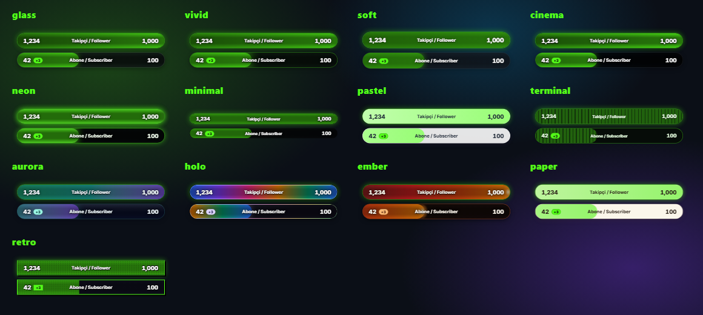

# Theme gallery

Thirteen themes, ten ready-made looks, and links that carry a look from one streamer to another. Every link below opens the online studio with that look applied, so you can try it on every overlay before you change anything in OBS.

## Themes

A theme sets the surface: background, borders, glow and texture. Your accent color, shape and font sit on top of it.

| Theme | Look | Try it |
| --- | --- | --- |
| `glass` | Frosted glass over your scene; the default. | [Open in the studio](https://iacbi.github.io/kick-streamer-overlays/studio.html?theme=glass) |
| `vivid` | Solid, saturated bars that read well over busy games. | [Open in the studio](https://iacbi.github.io/kick-streamer-overlays/studio.html?theme=vivid) |
| `soft` | Rounded, low-contrast panels with a gentle glow. | [Open in the studio](https://iacbi.github.io/kick-streamer-overlays/studio.html?theme=soft) |
| `cinema` | Dark, high-contrast bars with a film-title feel. | [Open in the studio](https://iacbi.github.io/kick-streamer-overlays/studio.html?theme=cinema) |
| `neon` | Glowing outlines for dark scenes. | [Open in the studio](https://iacbi.github.io/kick-streamer-overlays/studio.html?theme=neon) |
| `minimal` | Flat and thin: only the numbers and the bar. | [Open in the studio](https://iacbi.github.io/kick-streamer-overlays/studio.html?theme=minimal) |
| `pastel` | Light, soft colors for cozy streams. | [Open in the studio](https://iacbi.github.io/kick-streamer-overlays/studio.html?theme=pastel) |
| `terminal` | Scanlines and monospace, like a console. | [Open in the studio](https://iacbi.github.io/kick-streamer-overlays/studio.html?theme=terminal) |
| `aurora` | A slow shifting gradient in teal and violet. | [Open in the studio](https://iacbi.github.io/kick-streamer-overlays/studio.html?theme=aurora) |
| `holo` | An iridescent, holographic fill. | [Open in the studio](https://iacbi.github.io/kick-streamer-overlays/studio.html?theme=holo) |
| `ember` | Warm reds and oranges with a glow. | [Open in the studio](https://iacbi.github.io/kick-streamer-overlays/studio.html?theme=ember) |
| `paper` | Light paper cards with dark text. | [Open in the studio](https://iacbi.github.io/kick-streamer-overlays/studio.html?theme=paper) |
| `retro` | Pixel-style frames and dotted fills. | [Open in the studio](https://iacbi.github.io/kick-streamer-overlays/studio.html?theme=retro) |

## Quick looks

The studio's **Quick looks** buttons set theme, shape, font, motion and accent together. The same ten, as links:

| Look | Theme | Shape | Font | Motion | Accent | Try it |
| --- | --- | --- | --- | --- | --- | --- |
| Minimal | `minimal` | `square` | `inter` | `low` | `#ffffff` | [Open in the studio](https://iacbi.github.io/kick-streamer-overlays/studio.html?theme=minimal&shape=square&font=inter&motion=low&accent=%23ffffff) |
| Neon | `neon` | `rounded` | `mono` | `normal` | `#39ff14` | [Open in the studio](https://iacbi.github.io/kick-streamer-overlays/studio.html?theme=neon&shape=rounded&font=mono&motion=normal&accent=%2339ff14) |
| Pastel | `pastel` | `pill` | `nunito` | `normal` | `#c4a7ff` | [Open in the studio](https://iacbi.github.io/kick-streamer-overlays/studio.html?theme=pastel&shape=pill&font=nunito&motion=normal&accent=%23c4a7ff) |
| Night | `aurora` | `rounded` | `poppins` | `low` | `#5eead4` | [Open in the studio](https://iacbi.github.io/kick-streamer-overlays/studio.html?theme=aurora&shape=rounded&font=poppins&motion=low&accent=%235eead4) |
| Paper | `paper` | `rounded` | `nunito` | `normal` | `#c2410c` | [Open in the studio](https://iacbi.github.io/kick-streamer-overlays/studio.html?theme=paper&shape=rounded&font=nunito&motion=normal&accent=%23c2410c) |
| Cinema | `cinema` | `square` | `poppins` | `low` | `#f5c518` | [Open in the studio](https://iacbi.github.io/kick-streamer-overlays/studio.html?theme=cinema&shape=square&font=poppins&motion=low&accent=%23f5c518) |
| Holo | `holo` | `pill` | `poppins` | `normal` | `#a78bfa` | [Open in the studio](https://iacbi.github.io/kick-streamer-overlays/studio.html?theme=holo&shape=pill&font=poppins&motion=normal&accent=%23a78bfa) |
| Ember | `ember` | `rounded` | `inter` | `normal` | `#fb923c` | [Open in the studio](https://iacbi.github.io/kick-streamer-overlays/studio.html?theme=ember&shape=rounded&font=inter&motion=normal&accent=%23fb923c) |
| Retro | `retro` | `square` | `mono` | `normal` | `#ff4fd8` | [Open in the studio](https://iacbi.github.io/kick-streamer-overlays/studio.html?theme=retro&shape=square&font=mono&motion=normal&accent=%23ff4fd8) |
| Terminal | `terminal` | `square` | `mono` | `low` | `#22c55e` | [Open in the studio](https://iacbi.github.io/kick-streamer-overlays/studio.html?theme=terminal&shape=square&font=mono&motion=low&accent=%2322c55e) |

## Share your own look

1. Set theme, shape, font, motion and accent in the studio.
2. Press **Copy look link** under **Quick looks**. The link opens the online studio with your look.
3. Whoever gets it opens the link, or pastes it into **Paste a look link** in their own studio (also the one the relay serves) and presses **Apply**. Then **Save** keeps it.

A look link carries only those five settings. It never carries your channel, goals, texts, custom CSS or anything private, and the studio ignores any other setting in a look link.

The same five settings work in any overlay link too, under their English or Turkish names: `theme` (`stil`), `shape` (`sekil`), `font` (`yaziTipi`), `motion` (`animasyon`) and `accent` (`renk`). See [settings](settings.md).

Made a look you like? Share it in an [issue](https://github.com/IACBI/kick-streamer-overlays/issues/new) with its link and a screenshot, and it may join the quick looks.
